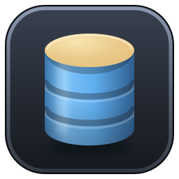
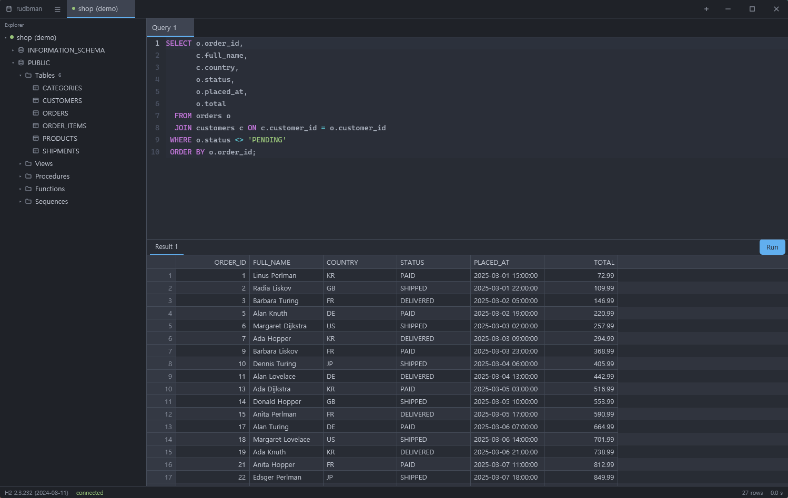
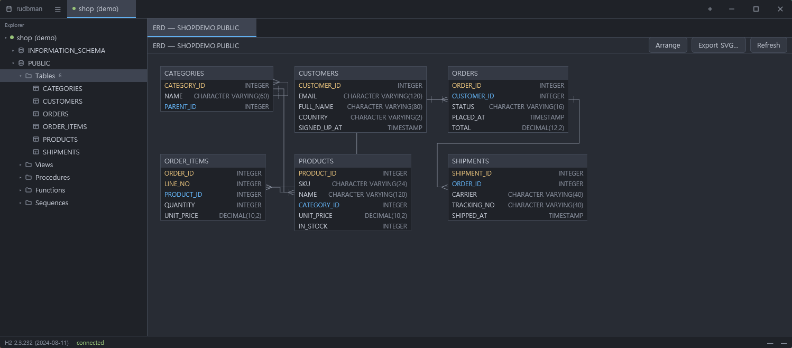
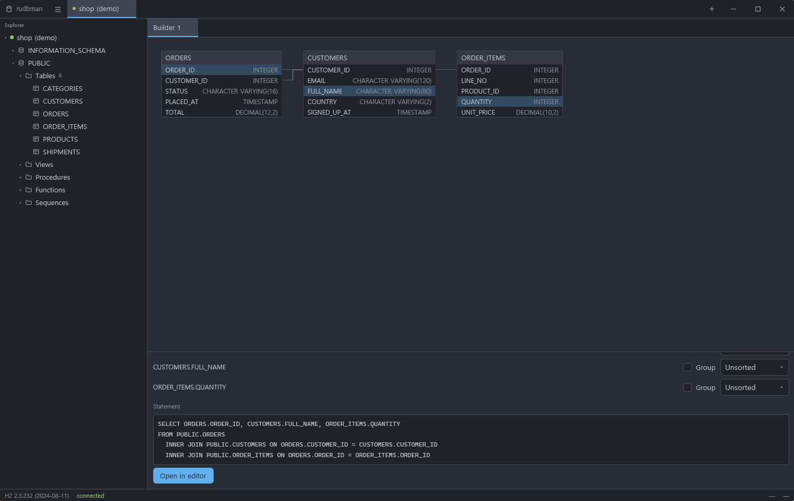

#  rudbman

[](https://github.com/xcomart/rudbman/actions/workflows/ci.yml)
[](LICENSE)


A multi-platform GUI database workbench written in Rust, built on
[gpui](https://gpui.rs) — the GPU-accelerated UI framework behind the Zed
editor — that talks to any database with a JDBC driver through an embedded
JVM bridge.

> **Status: early releases.** Everything below works today. Expect the rough
> edges of a first release; see [docs/status.md](docs/status.md) for what is
> known to be missing.



<p align="center">
  
  
</p>

## What works today

- **Any JDBC driver.** Drivers are downloaded from Maven Central by
  coordinate or picked from disk, the driver class is auto-detected from the
  JAR, and each connection gets its own isolated class loader. H2,
  PostgreSQL, MySQL, MariaDB, SQLite, Oracle, SQL Server and IBM Db2 come
  predefined, with their SQL dialects. Row data
  crosses the JNI boundary in a compact columnar batch format — not as one
  JSON string per row.
- **Connections as tabs**, each with its own work area: split panes, tabbed
  editors and table details, per-connection query numbering. Switching the
  connection tab switches the explorer and the whole work area with it. With
  nothing open, a welcome screen lists the saved connections and opens one in
  a click. Reopening a connection restores its tabs, split layout, SQL drafts,
  and query builders. Right-click a work tab to rename it; leave its name blank
  to return to the default. Workspaces save automatically and on close. SQL is
  restored without running it; result rows and unapplied database edits are not
  saved. Splitting copies the selected tab into the new pane. Drag a work tab to
  reorder it or move it to another pane, and drag a connection tab to reorder
  the connections. A pane disappears when its last tab closes, with the final
  pane kept open.
- **Connection folders.** Group saved connections by folder in the connection
  dialog. Click a folder heading to collapse or expand it, or focus it with
  <kbd>Tab</kbd> and press <kbd>Space</kbd> or <kbd>Enter</kbd>. Folded folders
  stay folded when you reopen the dialog during the same app session.
- **Connections that say why they failed.** A tab that could not connect, or
  whose session ended, shows the whole error and a hint in its work area, with
  **Reconnect** (in the same tab), **Edit connection…** and **Copy message**;
  a bastion's unknown host key can be trusted right there. While connecting
  the tab can be canceled, and an attempt gives up after the connection
  timeout in Settings (30 seconds unless changed).
- **SSH tunnels** with password or private-key auth, loopback binds only,
  and no PTY on the bastion — `nologin` jump hosts work. Secrets live in the
  OS keychain, never on disk, and credentials are masked out of logs and
  JDBC URLs; turn off **Remember password in the system keychain** on a
  profile to keep nothing and be asked on every connect.
- **The connection dialog keeps what you type.** Closing it with unsaved
  edits — Esc, Cancel or a click beside it — asks Save / Discard / Keep
  editing, and inside it <kbd>Ctrl</kbd>/<kbd>Cmd</kbd>+<kbd>N</kbd> makes a
  new profile and <kbd>Ctrl</kbd>/<kbd>Cmd</kbd>+<kbd>S</kbd> saves. A new
  profile starts with no driver chosen; a driver without its JAR offers
  **Download** right under the picker (from its Maven coordinate, with
  progress and cancel), and **Drivers…** opens on the driver the form names.
  The welcome list's right-click menu offers Connect, Edit…, Duplicate… and
  Delete….
- **A schema explorer** — catalogs, schemas, tables, views (materialized ones
  too), procedures, functions, sequences and triggers — and a detail panel with
  columns, keys, references in both directions, and DDL in a read-only,
  highlighted editor (the server's own text where the dialect offers it,
  rebuilt from the catalog where it does not). Every kind of object shows its
  `CREATE`, laid out for reading: one column to a line, a view's query as Format
  SQL writes it, a routine's or a trigger's body indented by block.
- **A SQL workbench**: an editor with incremental dialect-aware highlighting
  and IME support, SQL keyword/function/table/column completion (including table aliases),
  statement splitting, run-one/run-selection/run-all,
  cancellation, multiple result sets, and a virtualized grid that fetches rows
  as you scroll instead of loading the whole result — up to 200,000 rows per
  grid, with a note when the result has more.
  **Format SQL** (<kbd>Ctrl</kbd>/<kbd>Cmd</kbd>+<kbd>Shift</kbd>+<kbd>F</kbd>)
  lays out the selection, or the whole editor, in the sqlstyle.guide river
  layout. On a connection that does not commit each statement as it runs, the
  editor's **Commit** and **Rollback** buttons (<kbd>F11</kbd> /
  <kbd>F12</kbd>) end the transaction; while it is open the status bar says
  so, the connection tab wears a dot, the two buttons are lit, and grid
  applies, structure changes and transfers on that connection are refused —
  naming the query tab to commit from — rather than committing or discarding
  it. <kbd>Esc</kbd> in the editor or the results stops a running statement.
  A script that fails part way logs which statement of how many failed, with
  its SQL and the error, keeps the results of the statements before it, and
  selects the failed statement in the editor; error messages and log rows can
  be copied. The row count reads "500+ rows" while more remain to be fetched,
  and a run of writes reports the rows they affected.
  Completion opens while typing or with <kbd>Ctrl</kbd>+<kbd>Space</kbd>:
  use ↑/↓ to choose, Enter/Tab to insert, and Esc to dismiss. Names come from
  the current connection, with columns loaded on demand; comments and string
  literals do not trigger suggestions.
  Built-in function suggestions include `COUNT`, `SUM`, `AVG`, `MIN`, `MAX`
  and common scalar functions for the connection's dialect. Completing a
  function replaces its name while preserving any existing arguments.
- **BLOB/CLOB viewing and editing.** Double-click a LOB cell (including NULL)
  or choose **Open LOB** from its context menu. CLOBs use a text editor and
  UTF-8 files; BLOBs use editable hexadecimal byte pairs and binary files.
  **Save to file** exports the complete value. **Replace from file** snapshots
  a replacement without changing the database. **Add to changes** (Ctrl/Cmd+Enter)
  stages the value; the grid's existing **Apply** preview and transaction perform
  the database update. Empty values and NULL remain distinct. Read-only results
  can still be viewed and saved. The first 1 MiB is shown for larger values;
  these stay fully exportable and can be replaced from a file without loading
  the whole value into the editor. Result snapshots use temporary disk space
  and are removed when the result and its edits are released.
- **Multiline text cells** show the first line followed by visible `\n`
  separators. Double-click or choose **Open text editor** to edit the actual
  lines in the same viewer, then stage and Apply as usual. Copying and database
  writes keep the original line breaks; ordinary text remains a string value.
- **ERD diagrams** of a whole schema or catalog, from the explorer with
  <kbd>Ctrl</kbd>/<kbd>Cmd</kbd>+<kbd>E</kbd>. Tables are placed by a
  hierarchical (Sugiyama) layout of rudbman's own and joined by orthogonal
  routed edges; drag a table and the new position is saved per connection and
  restored next time. Export the diagram as SVG.
- **A visual query builder.** Drag tables out of the explorer onto a canvas,
  click columns to toggle them into the `SELECT` list, and drag column to
  column to join (`INNER`, `LEFT`, `RIGHT`, `FULL`) — or pick the two columns
  in the Joins form, which appears once two tables are on the canvas. The
  canvas and the form say which of these gestures to use until each is used. Forms cover `WHERE`,
  `GROUP BY` and `ORDER BY`, the SQL preview updates as you go with
  identifiers quoted the way the dialect wants them, and one click opens the
  statement in an editor.
- **Backup** of a schema or catalog to a replayable `.sql`: every `CREATE`
  first, every foreign-key `ALTER` after, then `INSERT`s ordered by a
  topological sort of the foreign keys, optionally gzipped, with progress and
  cancellation.
- **DB-to-DB transfer.** Copy tables between two open connections, by plain
  insert or by upsert — `MERGE`, `ON CONFLICT` or `ON DUPLICATE KEY` as the
  target dialect spells it. On a bad row, abort, skip it, or log it and carry
  on (batches are isolated with savepoints so one bad row does not cost the
  batch), with per-row progress for both copied and skipped rows. The target
  starts on another open connection rather than the source's, a transfer of a
  table into itself is refused, and "Empty the target table first" asks before
  it deletes, saying how many rows will go.
- **Script extraction**: any table to a replayable `.sql`, to CSV, or
  through a user template — streamed to the file inside the JVM with progress
  and cancellation. Script execution is the same editor pipeline: open a
  `.sql` file, run it, get per-statement errors. Ctrl/Cmd+S saves a query tab to
  its `.sql` file (asking where the first time) and "Save SQL file as…" saves
  it under a new name; the tab then takes the file's name, and a dot marks
  changes not yet saved. A file changed on disk since the tab read or saved it
  is never overwritten in place; the save asks where instead.
- **Closing never loses work silently.** A tab with staged row or structure
  changes refuses to close — and so do the pane and the connection tab
  holding it — until the changes are applied or discarded. A query tab bound
  to a `.sql` file with unsaved changes asks Save / Don't save / Cancel
  wherever it is closed from; a tab bound to no file is a draft and closes
  without asking. Closing a connection with an uncommitted transaction or a
  running statement asks first, and quitting lists everything it would lose.
  <kbd>Ctrl</kbd>+<kbd>W</kbd> closes the tab on top (on macOS
  <kbd>Cmd</kbd>+<kbd>W</kbd> still closes the pane), and
  <kbd>Ctrl</kbd>/<kbd>Cmd</kbd>+<kbd>Shift</kbd>+<kbd>T</kbd> reopens the
  query or builder tab closed most recently.
- **Context menus** on every surface that has actions worth reaching for —
  the explorer tree, the result grid, the editor, the ERD and builder
  canvases, and the tab strips.
- **Themes and languages**: UI and editor theme registries with live
  preview, import/export, and a user theme directory; eight UI languages
  (en, ko, ja, zh-CN, de, es, fr, ru).

## Keyboard shortcuts

On macOS read <kbd>Cmd</kbd> for <kbd>Ctrl</kbd> in the table, except where a
row says otherwise. The pane chords use <kbd>Alt</kbd> on Linux and Windows and
<kbd>Cmd</kbd> on macOS. Every command is also in the ☰ menu (the menu bar on
macOS), with its chord beside it.

| Where | Keys | Does |
|---|---|---|
| Window | <kbd>Ctrl</kbd>+<kbd>N</kbd> | Manage connections (in the connection dialog: new profile) |
| | <kbd>Ctrl</kbd>+<kbd>,</kbd> | Settings |
| | <kbd>Ctrl</kbd>+<kbd>B</kbd> | Show or hide the explorer |
| | <kbd>Ctrl</kbd>+<kbd>Q</kbd> | Quit (asks first when something would be lost) |
| Tabs | <kbd>Ctrl</kbd>+<kbd>T</kbd> | New query tab |
| | <kbd>Ctrl</kbd>+<kbd>W</kbd> | Close the tab on top (Linux and Windows) |
| | <kbd>Ctrl</kbd>+<kbd>Shift</kbd>+<kbd>T</kbd> | Reopen the query or builder tab closed last |
| | <kbd>Ctrl</kbd>+<kbd>PgDn</kbd> / <kbd>PgUp</kbd>, <kbd>Ctrl</kbd>+<kbd>Tab</kbd> / <kbd>Ctrl</kbd>+<kbd>Shift</kbd>+<kbd>Tab</kbd> | Next / previous tab of the pane (macOS: <kbd>Cmd</kbd>+<kbd>Alt</kbd>+<kbd>→</kbd> / <kbd>←</kbd>) |
| | <kbd>Ctrl</kbd>+<kbd>1</kbd>–<kbd>8</kbd>, <kbd>Ctrl</kbd>+<kbd>9</kbd> | That tab, the last tab |
| | <kbd>Ctrl</kbd>+<kbd>Alt</kbd>+<kbd>PgDn</kbd> / <kbd>PgUp</kbd> | Next / previous connection tab (Linux and Windows) |
| Panes | <kbd>Alt</kbd>+<kbd>Shift</kbd>+<kbd>D</kbd> / <kbd>S</kbd> | Split right / below |
| | <kbd>Alt</kbd>+<kbd>W</kbd> | Close the pane |
| | <kbd>Alt</kbd>+<kbd>]</kbd> / <kbd>[</kbd> | Next / previous pane, keyboard included |
| | <kbd>F6</kbd> / <kbd>Shift</kbd>+<kbd>F6</kbd> | Explorer → editor → results, and back |
| Files | <kbd>Ctrl</kbd>+<kbd>O</kbd> | Open a `.sql` file |
| | <kbd>Ctrl</kbd>+<kbd>S</kbd> / <kbd>Ctrl</kbd>+<kbd>Shift</kbd>+<kbd>S</kbd> | Save the query tab / save as (no save-as chord on macOS) |
| Explorer | <kbd>Ctrl</kbd>+<kbd>Enter</kbd> | Query the selected object |
| | <kbd>Ctrl</kbd>+<kbd>E</kbd> | ERD of the selection's schema |
| SQL editor | <kbd>Ctrl</kbd>+<kbd>Enter</kbd> | Run the statement under the caret |
| | <kbd>Ctrl</kbd>+<kbd>Alt</kbd>+<kbd>Enter</kbd> | Run the selection |
| | <kbd>Ctrl</kbd>+<kbd>Shift</kbd>+<kbd>Enter</kbd> | Run everything |
| | <kbd>Esc</kbd> | Stop the running statement (also in the results) |
| | <kbd>F11</kbd> / <kbd>F12</kbd> | Commit / roll back (manual-commit connections) |
| | <kbd>Ctrl</kbd>+<kbd>Shift</kbd>+<kbd>F</kbd> | Format SQL |
| | <kbd>Ctrl</kbd>+<kbd>Space</kbd> | Completion |
| | <kbd>Ctrl</kbd>+<kbd>F</kbd> / <kbd>Ctrl</kbd>+<kbd>H</kbd> | Find / replace |
| | <kbd>Ctrl</kbd>+<kbd>/</kbd> | Toggle comment |
| Data grid | <kbd>Delete</kbd> | Mark the row for deletion, or unmark it |
| | <kbd>Ctrl</kbd>+<kbd>0</kbd>, <kbd>Shift</kbd>+<kbd>Delete</kbd> | Set the cell to NULL |
| | <kbd>Alt</kbd>+<kbd>Insert</kbd> | Add a row |
| | <kbd>Ctrl</kbd>+<kbd>S</kbd>, <kbd>Ctrl</kbd>+<kbd>Enter</kbd> | Apply (shows the statements first) |
| | <kbd>F5</kbd> | Read the rows again |
| | <kbd>Ctrl</kbd>+<kbd>C</kbd> | Copy the selected cells |
| ERD | <kbd>Ctrl</kbd>+<kbd>=</kbd> / <kbd>-</kbd> / <kbd>0</kbd> | Zoom in / out / actual size |
| | <kbd>Ctrl</kbd>+<kbd>Shift</kbd>+<kbd>A</kbd> / <kbd>L</kbd> | Auto-arrange / switch to comment names |
| Dialogs | <kbd>Esc</kbd> | Close; over a running extraction, transfer or backup, ask whether to stop it |

## Installing

Download the build for your platform from
[Releases](https://github.com/xcomart/rudbman/releases). **No JDK needed** —
every download carries a Java runtime built with `jlink`, and rudbman uses the
one next to its executable.

- **Windows** — two downloads, the same program inside.
  - `…-setup.exe` is an installer. It installs into your user profile, so it
    needs no administrator rights and raises no UAC prompt, and it adds a
    Start-menu entry plus an **Apps & features** entry you can uninstall from
    later. Uninstalling removes only the program: settings, themes and saved
    connections stay.
  - `….zip` is the same tree, portable. Unzip it wherever you like and run
    `rudbman.exe` from inside the folder — keep the folder together, because
    the executable finds its Java runtime and bridge JAR beside itself.

  Either way the executable is self-signed at best, so SmartScreen may say
  "Windows protected your PC"; choose **More info → Run anyway**.
- **macOS** — unpack the `.tar.gz` and drag `rudbman.app` to Applications.
  The bundle is ad-hoc signed rather than notarized, so Gatekeeper quarantines
  it on arrival: the first launch needs **right-click → Open** instead of a
  double-click, and if macOS still refuses (newer versions offer no way
  through), drop the quarantine flag and launch normally:

  ```sh
  xattr -r -d com.apple.quarantine /Applications/rudbman.app
  ```

  On macOS 15 and later there is a second hurdle. The system asks each app
  separately for permission to reach the local network, and because the
  bundle is only ad-hoc signed it usually never gets the prompt and never
  appears under **System Settings → Privacy & Security → Local Network**,
  which offers no way to add an app by hand. The permission is then denied
  silently: connections to a database on your LAN — a `192.168.x.x` or
  `10.x.x.x` address, or a `.local` name — fail with "No route to host",
  while `localhost` connections work as usual. The dependable way through is
  to launch the binary from Terminal, whose execution context is always
  allowed on the local network:

  ```sh
  /Applications/rudbman.app/Contents/MacOS/rudbman
  ```

  It has to be the executable itself; `open rudbman.app` hands the launch to
  launchd and does not count. If you would rather try to get the prompt
  back, run `tccutil reset All com.aihouse.rudbman`, delete every copy of
  `rudbman.app` (empty the Trash too), reboot, then reinstall and launch —
  with an ad-hoc signature it may or may not ask. Updating to macOS 15.2 or
  newer, which fixed several of these cases, also helps.
- **Linux** — unpack the `.tar.gz` and run `./install.sh`. It copies the tree
  to `~/.local/share/rudbman`, links it from `~/.local/bin/rudbman`, and
  installs the desktop entry and icons. Needs no root, and the launcher in
  the application menu works whether or not `~/.local/bin` is on your `PATH`
  (add it to start rudbman from a shell too). The binary needs glibc 2.35 or
  newer: Ubuntu 22.04, Debian 12 and later, or a distribution built on them,
  MX Linux 23 among them. The script checks for it and for the system
  libraries rudbman needs — libxcb, xkbcommon with its X11 half and an EGL or
  Vulkan loader — and prints the command that installs any that are missing.

To use a JDK of your own instead of the bundled runtime, point
`RUDBMAN_JAVA_HOME` at it (Java 17 or newer).

## Building

Prerequisites: stable Rust, a JDK (17+) with Gradle wrapper support for the
bridge. The widget kit, the grid, the editor and the patched gpui come from a
pinned revision of [rugpui](https://github.com/xcomart/rugpui) fetched by Cargo
itself, so no separate checkout of it is needed.

```sh
# The Java half first: the Rust build refuses to proceed without the bridge JAR.
cd bridge && ./gradlew build && cd ..

# Then the workspace. Cargo fetches rugpui (and, through its patch table, gpui)
# from git on first build.
cargo build --release
```

A build from source has no bundled runtime, so it looks for a JVM on the
system — `RUDBMAN_JAVA_HOME`, then `JAVA_HOME`, then the usual locations. Only
the release archives ship a runtime of their own.

Running the tests mirrors CI: the bridge suite first, then the Rust
workspace, whose integration tests boot a real JVM against a real in-memory
H2 (the driver JAR is found in the Gradle cache, or pointed at with
`RUDBMAN_TEST_H2_JAR`):

```sh
cd bridge && ./gradlew build && cd ..
cargo test --workspace
```

On Linux, gpui links against `libxkbcommon` (with its X11 half),
`wayland-client` and `fontconfig` development packages; see
[.github/workflows/ci.yml](.github/workflows/ci.yml) for the exact list.

Release archives are built by
[.github/workflows/release.yml](.github/workflows/release.yml) from a version
tag: Gradle, then `jlink`, then `cargo`, then packaging.

## Architecture

SSH transport, tunnel ownership, connection validation and saving, and JVM
startup come from [rudbkit](https://github.com/xcomart/rudbkit), pinned to one
Git revision in the root Cargo manifest. Cargo fetches it automatically. The
application keeps its own settings, keychain, Java bridge protocol and dialog
layout; its SSH crate is a compatibility facade over the shared transport.


The design document — the JNI wire protocol, the columnar batch codec, the
data-plane rule that row data never crosses the JNI boundary, the SSH tunnel
lifecycle, and the milestone plan — lives in
[docs/architecture.md](docs/architecture.md). Current progress and
open items are tracked in [docs/status.md](docs/status.md).

The widget kit, the virtualized result grid and the code editor are not in this
repository. They are [rugpui](https://github.com/xcomart/rugpui), extracted so that
the three desktop applications built on them stop carrying byte-identical
copies of the same code. Nothing there knows what a database is: rudbman hands
the editor a `Highlighter` over `rudbman-sql`
(`crates/rudbman-app/src/sql_highlight.rs`) and the grid a `GridSource` over a
JDBC cursor.

Neither is the layer *above* the widgets. `rugpui-shell`, from the same
repository, is the window that draws its own title bar, the self-updater that
replaces the installed copy with the one GitHub published, the about and update
dialogs, the split-pane tree, the palette catalog and its editor, and the
pieces the settings form is built out of — each of them written once here and
then copied twice. It knows nothing about rudbman either: the name, the version,
the release endpoints, the words and the ignored-release tag are handed to it by
`crates/rudbman-app/src/app_identity.rs` at start-up.

gpui comes from a pinned revision of Zed's monorepo rather than from crates.io,
whose newest release (0.2.2) predates the split of the crate into a
platform-independent core, a `gpui_platform` facade and per-OS backends. Four of
those crates — `gpui`, `gpui_linux`, `gpui_macos`, `gpui_windows` — are patched
back over the git source, each change marked `RULOGMAN PATCH`: among them the
live title-bar switch, three X11 fixes and a macOS 26 blur fix upstream has no
answer for, all listed in rugpui's root manifest. rugpui vendors them and
rudbman's `[patch."https://github.com/zed-industries/zed"]` table points at
that copy, which is what keeps one gpui in the binary — two would make the
`Global`s the widgets install invisible to the application. rugpui is the
single origin of those trees:
[rulogman](https://github.com/xcomart/rulogman) points its patch table at the
same copy, so a fix made there reaches both projects.

## Contributing

See the [contribution guide](CONTRIBUTING.md) for development setup, bridge and
database tests, project structure and the workflow for submitting changes.

## License

[MIT](LICENSE). The gpui crates rugpui vendors keep their upstream licenses.
