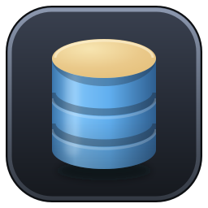
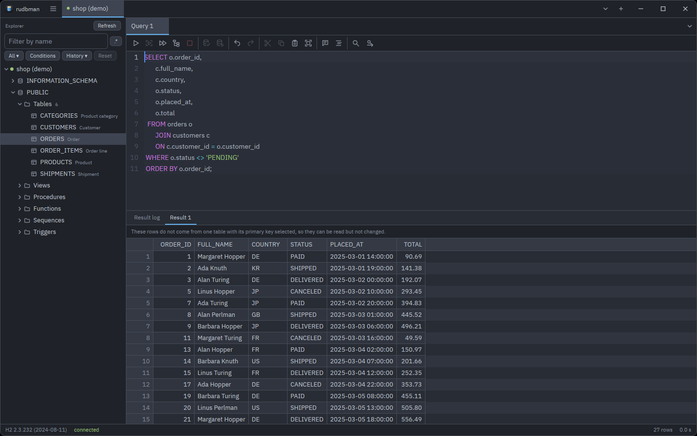
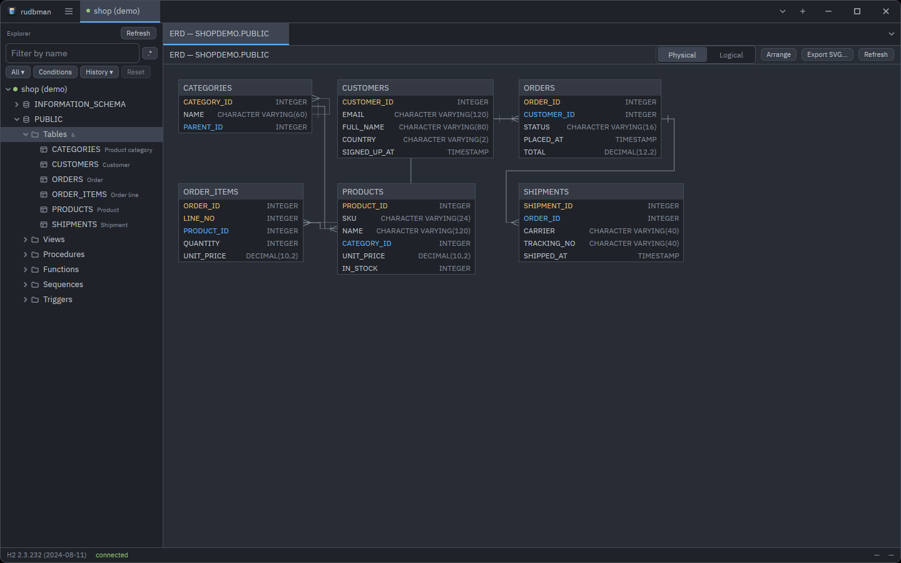
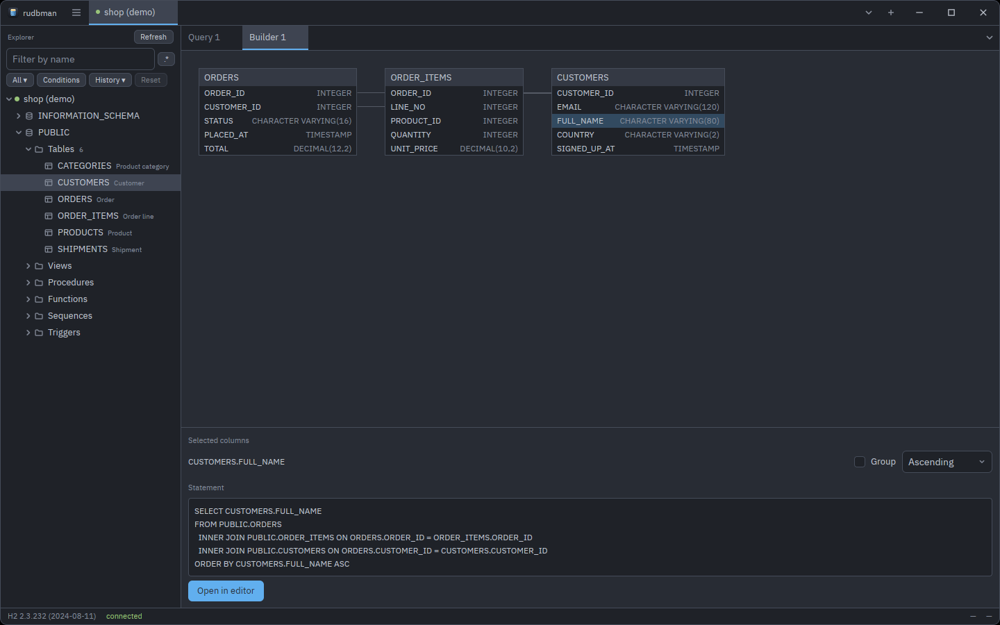

#  rudbman

[](https://github.com/xcomart/rudbman/actions/workflows/ci.yml)
[](LICENSE)


A multi-platform GUI database workbench written in Rust, built on
[gpui](https://gpui.rs) — the GPU-accelerated UI framework behind the Zed
editor — that talks to any database with a JDBC driver through an embedded
JVM bridge. The [user guide](docs/user-guide.md) walks through everything it
does; this page is the short version.



<p align="center">
  
  
</p>

## What works today

- **Any JDBC driver** — downloaded from Maven Central or picked from disk; eight popular databases come predefined.
- **Connection tabs** — each connection keeps its own panes and tabs, restored when it reopens.
- **Connection folders** — saved connections grouped into folders that fold away.
- **Clear connection errors** — a failed tab shows the whole error with Reconnect and Edit connection.
- **SSH tunnels** — password or key auth through a bastion; secrets stay in the OS keychain.
- **Connection dialog** — asks before dropping unsaved edits and downloads a missing driver in place.
- **Schema explorer** — every object type, name and regex filters, and a detail panel with columns, keys and DDL.
- **SQL workbench** — dialect-aware highlighting, completion, Format SQL, transactions and a virtualized result grid.
- **Query history** — the statements each connection ran, searchable and reopened in a new tab.
- **Execution plans** — a statement's plan without running it.
- **BLOB/CLOB editing** — view, edit, save and replace large values, applied with the grid's changes.
- **Table filters** — a `WHERE` strip narrows a table's rows.
- **Multiline text cells** — edited as real lines in a text viewer.
- **ERD diagrams** — schema diagrams laid out automatically, with saved positions and SVG export.
- **Visual query builder** — drag tables, tick columns and drag joins, with a live SQL preview.
- **Backup** — a schema or catalog to a replayable, optionally gzipped `.sql`.
- **Restore** — a backup or another tool's dump script run into a schema the way that product's client reads it.
- **DB-to-DB transfer** — tables copied between connections by insert or upsert, with bad-row handling.
- **Script extraction** — tables to SQL, CSV or a template; `.sql` files opened, run and saved.
- **Safe closing** — staged edits, unsaved files and open transactions are never dropped silently.
- **Context menus** — on every surface, and reachable from the keyboard.
- **Corner notices** — short messages for what belongs to no tab.
- **Themes and languages** — UI and editor themes, eight interface languages and a scalable interface size.

## Installing

Download the build for your platform from
[Releases](https://github.com/xcomart/rudbman/releases). **No JDK needed** —
every download carries a Java runtime built with `jlink`, and rudbman uses the
one next to its executable.

- **Windows** — two downloads, the same program inside.
  - `…-setup.exe` is an installer. It installs into your user profile, so it
    needs no administrator rights and raises no UAC prompt, and it adds a
    Start-menu entry plus an **Apps & features** entry you can uninstall from
    later. Uninstalling removes only the program: settings, themes and saved
    connections stay.
  - `….zip` is the same tree, portable. Unzip it wherever you like and run
    `rudbman.exe` from inside the folder — keep the folder together, because
    the executable finds its Java runtime and bridge JAR beside itself.

  Either way the executable is self-signed at best, so SmartScreen may say
  "Windows protected your PC"; choose **More info → Run anyway**.
- **macOS** — unpack the `.tar.gz` and drag `rudbman.app` to Applications.
  The bundle is ad-hoc signed rather than notarized, so Gatekeeper quarantines
  it on arrival: the first launch needs **right-click → Open** instead of a
  double-click, and if macOS still refuses (newer versions offer no way
  through), drop the quarantine flag and launch normally:

  ```sh
  xattr -r -d com.apple.quarantine /Applications/rudbman.app
  ```

  On macOS 15 and later there is a second hurdle. The system asks each app
  separately for permission to reach the local network, and because the
  bundle is only ad-hoc signed it usually never gets the prompt and never
  appears under **System Settings → Privacy & Security → Local Network**,
  which offers no way to add an app by hand. The permission is then denied
  silently: connections to a database on your LAN — a `192.168.x.x` or
  `10.x.x.x` address, or a `.local` name — fail with "No route to host",
  while `localhost` connections work as usual. The dependable way through is
  to launch the binary from Terminal, whose execution context is always
  allowed on the local network:

  ```sh
  /Applications/rudbman.app/Contents/MacOS/rudbman
  ```

  It has to be the executable itself; `open rudbman.app` hands the launch to
  launchd and does not count. If you would rather try to get the prompt
  back, run `tccutil reset All com.aihouse.rudbman`, delete every copy of
  `rudbman.app` (empty the Trash too), reboot, then reinstall and launch —
  with an ad-hoc signature it may or may not ask. Updating to macOS 15.2 or
  newer, which fixed several of these cases, also helps.
- **Linux** — unpack the `.tar.gz` and run `./install.sh`. It copies the tree
  to `~/.local/share/rudbman`, links it from `~/.local/bin/rudbman`, and
  installs the desktop entry and icons. Needs no root, and the launcher in
  the application menu works whether or not `~/.local/bin` is on your `PATH`
  (add it to start rudbman from a shell too). The binary needs glibc 2.35 or
  newer: Ubuntu 22.04, Debian 12 and later, or a distribution built on them,
  MX Linux 23 among them. The script checks for it and for the system
  libraries rudbman needs — libxcb, xkbcommon with its X11 half and an EGL or
  Vulkan loader — and prints the command that installs any that are missing.

The bundled runtime is always used when it is there. A copy without one, such
as a build from source, takes the runtime `RUDBMAN_JAVA_HOME` points at, then
`JAVA_HOME` (Java 17 or newer).

## Building

Prerequisites: stable Rust, a JDK (17+) with Gradle wrapper support for the
bridge. The widget kit, the grid, the editor and the patched gpui come from a
pinned revision of [rugpui](https://github.com/xcomart/rugpui) fetched by Cargo
itself, so no separate checkout of it is needed.

```sh
# The Java half first: the Rust build refuses to proceed without the bridge JAR.
cd bridge && ./gradlew build && cd ..

# Then the workspace. Cargo fetches rugpui (and, through its patch table, gpui)
# from git on first build.
cargo build --release
```

A build from source has no bundled runtime, so it looks for a JVM on the
system — `RUDBMAN_JAVA_HOME`, then `JAVA_HOME`, then the usual locations. Only
the release archives ship a runtime of their own.

Running the tests mirrors CI: the bridge suite first, then the Rust
workspace, whose integration tests boot a real JVM against a real in-memory
H2 (the driver JAR is found in the Gradle cache, or pointed at with
`RUDBMAN_TEST_H2_JAR`):

```sh
cd bridge && ./gradlew build && cd ..
cargo test --workspace
```

On Linux, gpui links against `libxkbcommon` (with its X11 half),
`wayland-client` and `fontconfig` development packages; see
[.github/workflows/ci.yml](.github/workflows/ci.yml) for the exact list.

Release archives are built by
[.github/workflows/release.yml](.github/workflows/release.yml) from a version
tag: Gradle, then `jlink`, then `cargo`, then packaging.

## Architecture

SSH transport, tunnel ownership, connection validation and saving, and JVM
startup come from [rudbkit](https://github.com/xcomart/rudbkit), pinned to one
Git revision in the root Cargo manifest. Cargo fetches it automatically. The
application keeps its own settings, keychain, Java bridge protocol and dialog
layout; its SSH crate is a compatibility facade over the shared transport.

The widget kit, the virtualized result grid and the code editor are not in this
repository. They are [rugpui](https://github.com/xcomart/rugpui), extracted so that
the three desktop applications built on them stop carrying byte-identical
copies of the same code. Nothing there knows what a database is: rudbman hands
the editor a `Highlighter` over `rudbman-sql`
(`crates/rudbman-app/src/sql_highlight.rs`) and the grid a `GridSource` over a
JDBC cursor.

Neither is the layer *above* the widgets. `rugpui-shell`, from the same
repository, is the window that draws its own title bar, the self-updater that
replaces the installed copy with the one GitHub published, the about and update
dialogs, the split-pane tree, the palette catalog and its editor, and the
pieces the settings form is built out of — each of them written once here and
then copied twice. It knows nothing about rudbman either: the name, the version,
the release endpoints, the words and the ignored-release tag are handed to it by
`crates/rudbman-app/src/app_identity.rs` at start-up.

gpui comes from a pinned revision of Zed's monorepo rather than from crates.io,
whose newest release (0.2.2) predates the split of the crate into a
platform-independent core, a `gpui_platform` facade and per-OS backends. Four of
those crates — `gpui`, `gpui_linux`, `gpui_macos`, `gpui_windows` — are patched
back over the git source, each change marked `RULOGMAN PATCH`: among them the
live title-bar switch, three X11 fixes and a macOS 26 blur fix upstream has no
answer for, all listed in rugpui's root manifest. rugpui vendors them and
rudbman's `[patch."https://github.com/zed-industries/zed"]` table points at
that copy, which is what keeps one gpui in the binary — two would make the
`Global`s the widgets install invisible to the application. rugpui is the
single origin of those trees:
[rulogman](https://github.com/xcomart/rulogman) points its patch table at the
same copy, so a fix made there reaches both projects.

### Third-party libraries

The heavy lifting is done by these projects:

| Library | Role |
| --- | --- |
| [gpui](https://github.com/zed-industries/zed/tree/main/crates/gpui) | GPU-accelerated UI framework, from the Zed editor (a pinned git revision, partly vendored and patched in rugpui) |
| [jni](https://github.com/jni-rs/jni-rs) | Starts the embedded JVM and calls into the JDBC bridge |
| [Gson](https://github.com/google/gson) | The bridge's one Java dependency: JSON for metadata and requests |
| [russh](https://github.com/warp-tech/russh) | Pure-Rust SSH client behind the tunnels, through rudbkit |
| [tokio](https://github.com/tokio-rs/tokio) | Async runtime for the SSH tunnel |
| [keyring](https://github.com/open-source-cooperative/keyring-rs) | OS credential store: Windows Credential Manager, macOS Keychain, Secret Service |
| [directories](https://github.com/soc/directories-rs) | Per-platform configuration paths, and the home directory the file dialogs fall back to |
| [ureq](https://github.com/algesten/ureq) | The one HTTPS client: driver downloads from Maven Central, and the update check |

Supporting crates:
[serde](https://github.com/serde-rs/serde) /
[serde_json](https://github.com/serde-rs/json) (profiles, settings, workspaces
and the bridge's metadata),
[uuid](https://github.com/uuid-rs/uuid) (profile and driver identity),
[anyhow](https://github.com/dtolnay/anyhow) /
[thiserror](https://github.com/dtolnay/thiserror) (errors),
[log](https://github.com/rust-lang/log) /
[env_logger](https://github.com/rust-cli/env_logger) (logging),
[futures](https://github.com/rust-lang/futures-rs) /
[async-trait](https://github.com/dtolnay/async-trait) (async glue),
[parking_lot](https://github.com/Amanieu/parking_lot),
[tempfile](https://github.com/Stebalien/tempfile) (LOB snapshots),
[flate2](https://github.com/rust-lang/flate2-rs) (reading a gzipped backup),
[chrono](https://github.com/chronotope/chrono) (query history timestamps),
[regex](https://github.com/rust-lang/regex) (the explorer filter),
[unicode-width](https://github.com/unicode-rs/unicode-width) (ERD box widths),
[rust-i18n](https://github.com/longbridge/rust-i18n) /
[sys-locale](https://github.com/1Password/sys-locale) (localization).

Linux only: [secret-service](https://github.com/hwchen/secret-service-rs)
(creating a default keyring when there is none). Windows only:
[windows-rs](https://github.com/microsoft/windows-rs) (the parent console for
`--version`), [winresource](https://github.com/BenjaminRi/winresource) (icon
embedding). Tests additionally use [H2](https://github.com/h2database/h2database)
and [JUnit](https://github.com/junit-team/junit5) on the bridge side.

## AI-assisted development

Parts of the code in this repository were generated with AI coding agents. That
code is held to the same tests and CI checks as code written by hand, and the
maintainers are responsible for it in the same way. If you use an agent to
contribute, first read
[Using AI coding agents](CONTRIBUTING.md#using-ai-coding-agents) in the
contribution guide.

## Contributing

See the [contribution guide](CONTRIBUTING.md) for development setup, bridge and
database tests, project structure and the workflow for submitting changes.

## License

[MIT](LICENSE). The gpui crates rugpui vendors keep their upstream licenses.
