# rudbman user guide

rudbman is a database workbench: one window, a tab for each open connection,
a schema explorer beside it, and a work area of SQL editors, table data,
structure editors, diagrams and query builders. It talks to any database that
has a JDBC driver, through a Java runtime it starts inside itself. This guide
covers everything the application does. The [README](../README.md) is the
short version.

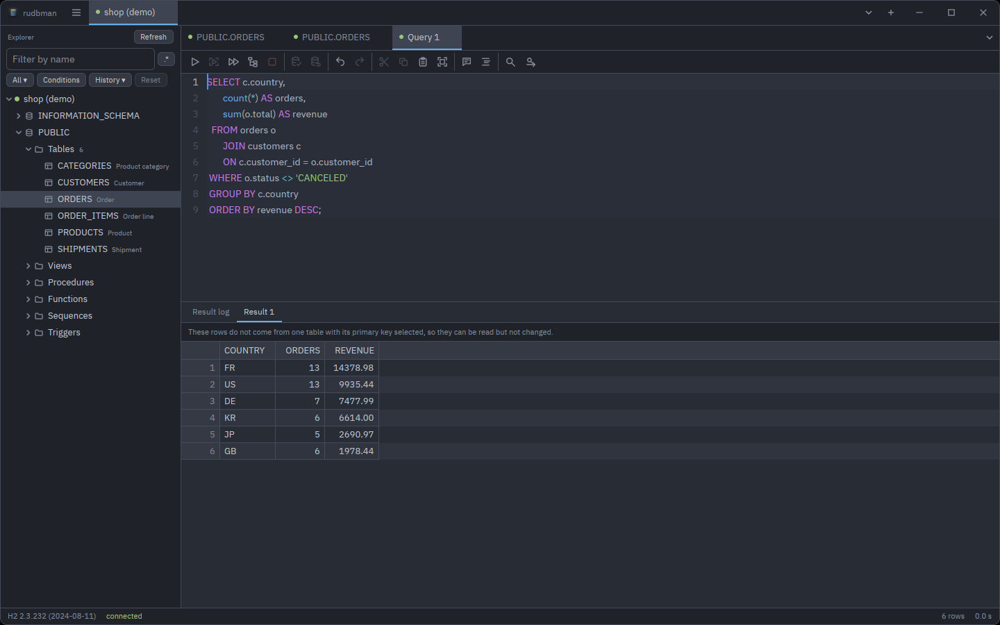

## Contents

- [Getting started](#getting-started)
- [Connections](#connections)
- [Tabs, panes and workspaces](#tabs-panes-and-workspaces)
- [The explorer](#the-explorer)
- [Queries](#queries)
- [Table data](#table-data)
- [Table structure](#table-structure)
- [ERD diagrams](#erd-diagrams)
- [The query builder](#the-query-builder)
- [Extracting a script](#extracting-a-script)
- [Backing up a schema](#backing-up-a-schema)
- [Transferring rows](#transferring-rows)
- [Settings](#settings)
- [Updating](#updating)
- [Keyboard shortcuts](#keyboard-shortcuts)
- [Where rudbman keeps things](#where-rudbman-keeps-things)
- [Troubleshooting](#troubleshooting)

Throughout this guide, read <kbd>Cmd</kbd> for <kbd>Ctrl</kbd> on macOS unless
a line says otherwise. The commands that live in the ☰ menu on Linux and
Windows are in the menu bar on macOS.

## Getting started

### Installing

Download the build for your platform from the
[Releases](https://github.com/xcomart/rudbman/releases) page, or on Windows
install it with `winget install Xcomart.Rudbman`. Every download carries its
own Java runtime, so no JDK has to be installed. The
[README](../README.md#installing) walks through each platform: the winget
package, the Windows installer and portable zip, the macOS Gatekeeper and local-network steps, and
the Linux `install.sh`.

rudbman ships no JDBC drivers. The first time you connect to a product, the
connection dialog offers to download its driver from Maven Central, or you can
point it at a JAR you already have — see [Drivers](#drivers).

### How rudbman reaches a database

rudbman is written in Rust, and JDBC drivers are Java. The two meet inside the
one process: rudbman starts a Java runtime the first time something needs it
(the first connection or the first look inside a driver JAR) and keeps it until
it quits. Each connection loads its driver in a class loader of its own, so two
versions of the same driver can be open at once. Rows come back in compact
binary batches rather than one object at a time, and the result grids fetch
them as you scroll.

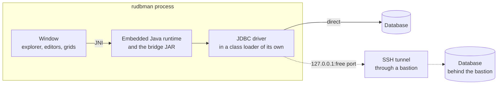

When a connection goes through an [SSH tunnel](#ssh-tunnel), rudbman opens the
tunnel first, binds a free port on `127.0.0.1`, and hands the driver a URL that
points there.

### The window

| Part | Where | What it holds |
| --- | --- | --- |
| **Tab strip** | Along the top | The ☰ menu button, one tab per open connection, **▾** (all connections), **+** (manage connections) and, when rudbman draws its own title bar, the window buttons. |
| **Explorer** | Down the left | The schema tree of the connection whose tab is in front, with a filter over it. <kbd>Ctrl</kbd>+<kbd>B</kbd> shows or hides it; drag its edge to resize it. |
| **Work area** | The rest | One or more panes, each with its own strip of tabs: query tabs, table details, table data, structure editors, ERDs and query builders. Switching the connection tab switches the whole work area with it. |
| **Status bar** | Along the bottom | The product and version, the connection state, an *uncommitted transaction* cell while one is open, and the row count and time of the last statement. |

<kbd>F6</kbd> and <kbd>Shift</kbd>+<kbd>F6</kbd> move the keyboard between the
explorer, the editor and the results.

### The welcome screen

With no connection open, the work area is the welcome screen: the name, a
**Manage connections…** button, and — once something has been saved — the
**Saved connections**, grouped under their folders.

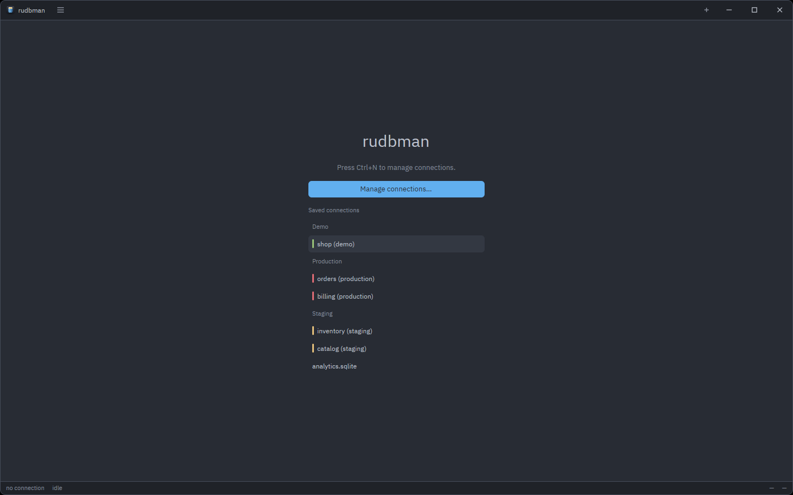

- **Click a saved connection to connect at once.** The only exception is a
  profile that does not remember its password: the connection dialog opens
  over it and asks for one.
- **Right-click a row** (or <kbd>Shift</kbd>+<kbd>F10</kbd> on a focused row)
  for **Connect**, **Edit…**, **Duplicate…** and **Delete…**. The last three
  open the connection dialog: on the profile, with a copy made and selected,
  or with the delete question already up.
- A colored stripe in front of a row is the profile's **Tag**.

## Connections

### The connection dialog

**Manage connections…** (<kbd>Ctrl</kbd>+<kbd>N</kbd>, the **+** at the end of
the tab strip, or the welcome screen's button) opens the dialog on the first
saved profile, or on a new one when nothing is saved yet.

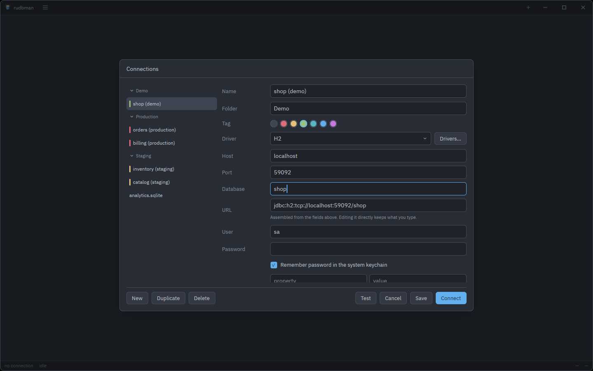

The list on the left groups the profiles by **Folder**. Click a folder heading
(or focus it with <kbd>Tab</kbd> and press <kbd>Space</kbd> or
<kbd>Enter</kbd>) to fold it; a folded folder stays folded the next time the
dialog opens during the same run of the application. Picking another profile
keeps what you typed into this one, and **Save** writes every profile you
edited.

The form, from the top:

| Field | Notes |
| --- | --- |
| **Name** | Required. A new profile starts as "New connection". |
| **Folder** | Optional. Profiles with the same folder are listed together here and on the welcome screen. |
| **Tag** | None, or one of six colors. It marks the profile on the welcome screen, its root in the explorer and the dot on its work tabs. |
| **Driver** | Starts empty on a new profile. **Drivers…** beside it opens the [driver manager](#drivers) on the driver the form names. |
| **Host**, **Port**, **Database** | One field for each hole in the driver's URL template. **Database** stands for whatever the template calls it: a database, an Oracle service, a SID or an SQLite file. **Port** starts at the driver's default port. |
| **URL** | Assembled from the fields above as you type. Edit it directly and it keeps what you type — "Typed by hand; the fields above no longer change it." — until you press **Rebuild**. |
| **User**, **Password** | The password is masked, and read from the system keychain when a saved profile is shown. |
| **Remember password in the system keychain** | On by default. Off, rudbman keeps neither the password nor the tunnel's secret anywhere — and deletes what it had kept — and asks for them on every connect. |
| **Driver properties** | Key/value rows passed to the driver, with **Add a property**. A row with no key is dropped. |
| **Behavior** | See [below](#behavior). |
| **SSH tunnel** | Folded unless it is on. See [SSH tunnel](#ssh-tunnel). |
| **Hide in the explorer** | Folded unless it holds something. See [Hide in the explorer](#hide-in-the-explorer). |

A driver that has no JAR yet says so under the picker. When the driver has a
Maven coordinate, **Download** sits right there, with progress and **Cancel**,
so a first connection to a new product needs no trip to the driver manager.

#### Behavior

| Switch | Default | What it does |
| --- | --- | --- |
| **Open the connection read-only** | off | Opens the session read-only and refuses every write — see [Guarded connections](#guarded-connections). |
| **Commit each statement as it runs** | on | Auto-commit. Off, the statements you run join a transaction you end with **Commit** or **Rollback** — see [Transactions](#transactions). |
| **Ask before running a write statement** | on | Asks before a query tab sends a statement that changes data. A new profile takes its starting value from Settings. |
| **Keep the connection alive with a periodic query** | off | On, two fields appear: the interval in seconds (300) and the query (`select 1`). |

#### SSH tunnel

Tick **Connect through an SSH bastion** to reach a database that only a
bastion host can see.

| Field | Notes |
| --- | --- |
| **Bastion** | The SSH host and its port (22). |
| **Bastion user** | The SSH login. |
| **Authentication** | **SSH agent** (the default; nothing is stored), **Private key**, or **Password**. |
| **Key file** | For **Private key**: an OpenSSH or PKCS#8 PEM key. A leading `~` is the home directory of whoever runs rudbman. |
| **Key passphrase** / **Bastion password** | Masked, and kept in the keychain like the database password. |
| **Database** | The database's host and port *as the bastion sees them*, for example `db.internal` and `5432`. |

rudbman binds a free port on `127.0.0.1` — never on every interface — and
points the driver there, so the database host and port in the URL are replaced
with the tunnel's. A URL with no host and port to replace, such as an SQLite
file, cannot go through a tunnel. The bastion is asked for no terminal, so a
jump host whose login shell is `nologin` works. A single bastion is supported;
chains of jump hosts are not.

Host keys are trusted on first use and kept in rudbman's own `known_hosts`
file, not in `~/.ssh/known_hosts`. An unknown key is refused with its full
fingerprint shown, and **Trust this key** (after **Test**) or **Trust the key
and reconnect** (on a failed tab) adds it. A key that *changed* is refused with
no button to accept it: if the change is expected, remove the old line from
`known_hosts` by hand.

A tunnel that breaks is never repaired behind your back: the connection tab
says the tunnel closed and offers **Reconnect**.

#### Hide in the explorer

Some databases carry schemas or objects you never want to scroll past —
temporary schemas, recycle-bin tables, system catalogs. This section hides them
from the explorer for this profile, for good.

- **Catalogs**, **Schemas** and **Objects** each take one regular expression a
  line, matched against the **whole** name, case ignored: `pg_temp_.*`,
  `BIN\$.*`, `template[01]`.
- **Show only what the list matches** turns a list around, as SQL
  Workbench/J's inclusion filters do.
- **Applies to** picks the folders the object list acts on (all six by
  default).
- A catalog or schema level left with one member is skipped, as if the others
  were never there. A level whose members are all hidden is left empty rather
  than skipped.
- A line that is not a valid regular expression is named under its field, and
  **Save** is refused until it is fixed.

Saving the profile while it is connected reloads its tree with the new lists,
keeping what was expanded. To narrow the tree for the moment rather than for
good, use the explorer's own [filter](#filtering-the-tree).

#### Testing, saving and connecting

| Button | What it does |
| --- | --- |
| **New** | A new, empty profile. <kbd>Ctrl</kbd>+<kbd>N</kbd> inside the dialog does the same. |
| **Duplicate** | A copy named "… (copy)". The password is not copied. |
| **Delete** | Asks first, then removes the profile and its saved secrets. |
| **Test** | Connects with what is on the form — without saving it — and says "Connected to *product*." or why it could not, with a hint. |
| **Cancel** | Closes the dialog. |
| **Save** | Saves every profile edited. <kbd>Ctrl</kbd>+<kbd>S</kbd> does the same. |
| **Connect** | Saves, closes the dialog and opens the connection. <kbd>Enter</kbd> in a field does the same. |

Closing the dialog with unsaved edits — <kbd>Esc</kbd>, **Cancel** or a click
beside it — asks **Keep editing**, **Discard** or **Save**.

### Drivers

**Drivers…** turns the connection dialog into the driver manager. A driver
definition is a name, the driver class, a URL template, a default port, a SQL
dialect, a Maven coordinate and the JAR files.

Eight products are defined out of the box, each with the dialect rudbman uses
for its highlighting, quoting, paging and DDL:

| Driver | Maven coordinate | URL template | Port |
| --- | --- | --- | --- |
| H2 | `com.h2database:h2:2.3.232` | `jdbc:h2:tcp://{host}:{port}/{database}` | 9092 |
| PostgreSQL | `org.postgresql:postgresql:42.7.4` | `jdbc:postgresql://{host}:{port}/{database}` | 5432 |
| MySQL | `com.mysql:mysql-connector-j:9.1.0` | `jdbc:mysql://{host}:{port}/{database}` | 3306 |
| MariaDB | `org.mariadb.jdbc:mariadb-java-client:3.5.1` | `jdbc:mariadb://{host}:{port}/{database}` | 3306 |
| SQLite | `org.xerial:sqlite-jdbc:3.47.1.0` | `jdbc:sqlite:{file}` | — |
| Oracle Thin | `com.oracle.database.jdbc:ojdbc11:23.6.0.24.10` | `jdbc:oracle:thin:@//{host}:{port}/{service}` | 1521 |
| Microsoft SQL Server | `com.microsoft.sqlserver:mssql-jdbc:12.8.1.jre11` | `jdbc:sqlserver://{host}:{port};databaseName={database}` | 1433 |
| IBM Db2 | `com.ibm.db2:jcc:12.1.5.0` | `jdbc:db2://{host}:{port}/{database}` | 50000 |

None of them comes with its JAR. To give a driver one:

- **Download** fetches the coordinate's JAR from Maven Central, checks it
  against the SHA-1 Central publishes, and stores it in the `drivers` folder of
  the configuration directory. Only that one artifact is fetched, not its
  dependencies, which is all the drivers above need.
- **Add a JAR…** picks one or more files from disk, left where they are. A JAR
  that has since gone missing is marked *missing*; **Remove** takes one off.

**Detect** looks inside the JARs for the driver class. The first look starts
the Java runtime, which can take a few seconds. When a JAR holds several
drivers, the one its vendor declares is listed first and marked
*recommended*; a JAR that holds none — a sources or javadoc JAR picked by
mistake — is said to hold none.

**Table comments** and **Column comments** are for products whose driver
reports no comments through JDBC. Tick **Read table comments with a query** and
give a query that returns the table name and the comment, in that order;
`${catalog}` and `${schema}` are filled in. The column query returns the table
name, the column name and the comment.

**New** adds a driver of your own — any JDBC driver works, with the generic
dialect if none fits — and **Delete** removes a definition after asking.
Profiles that used it are left alone. Adding or removing a JAR and finishing a
download are saved at once; other edits are saved with **Save**, and **Close**
leaves without saving them.

> **H2 embedded.** The H2 template reaches an H2 server. For a database file,
> edit the profile's **URL** to `jdbc:h2:file:/path/to/db`.

### Connecting, and when it fails

**Connect** opens a tab at once, in front, and its work area says
"Connecting to “*name*”…" with **Cancel**. The attempt gives up after the
**Connection timeout** in [Settings](#database) — 30 seconds unless changed.
Once connected, the explorer opens onto the database and schema the session
landed in, and the profile's saved [workspace](#what-is-kept-between-sessions)
comes back.

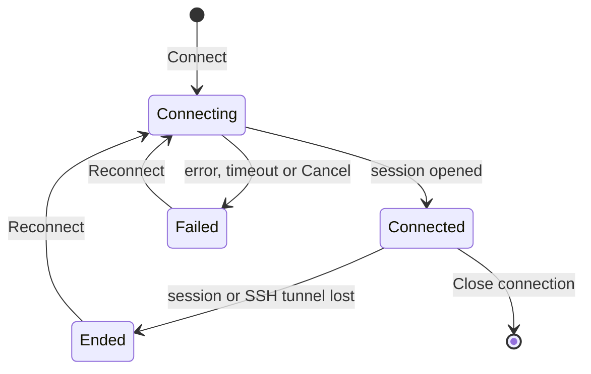

A tab that could not connect, or whose session ended, keeps its place and
says why in its work area: the whole message, a one-line hint, and

- **Reconnect** — tries again in the same tab, re-reading the profile, so a
  fix made with **Edit connection…** is picked up;
- **Edit connection…** — opens the connection dialog on the profile;
- **Copy message** — puts the error on the clipboard;
- **Trust the key and reconnect** — only when the bastion's host key is not
  trusted yet.

When the tab still has work tabs open, the same message is a band above them,
so nothing you had open is closed. The dot in front of the tab's name is green
while connected and red when it failed or ended.

### Passwords and the keychain

Passwords and the tunnel's password or key passphrase are kept in the
operating system's keychain — Windows Credential Manager, the macOS Keychain,
or the Secret Service (GNOME Keyring, KWallet) on Linux — under the service
name `rudbman`. They are never written to disk by rudbman. If no keychain is
available, a notice says so at start-up: saved passwords cannot be read, and
connecting sends an empty password unless you type one.

A profile with **Remember password in the system keychain** off asks for the
password on every connect, in the connection dialog, with the keyboard in the
**Password** field: type it and press **Connect**.

## Tabs, panes and workspaces

### Connection tabs

Each open connection is a tab in the strip along the top. Drag a tab to
reorder it; **▾** lists them all. Right-click a connection tab for:

- **New query** and **New query builder** (while connected);
- **Query history…**;
- **Reconnect** (when the tab failed or ended) and **Edit connection…**;
- **Close connection**.

<kbd>Ctrl</kbd>+<kbd>Alt</kbd>+<kbd>PgDn</kbd> / <kbd>PgUp</kbd> moves to the
next or previous connection tab (Linux and Windows).

### Work tabs and panes

Everything you open on a connection is a tab in a pane of its work area: query
tabs (**Query 1**, **Query 2**, …), table details and data (named after the
table), structure editors, ERDs and query builders (**Builder 1**, …).

- **Split** a pane with **Split right** (<kbd>Alt</kbd>+<kbd>Shift</kbd>+<kbd>D</kbd>)
  or **Split below** (<kbd>Alt</kbd>+<kbd>Shift</kbd>+<kbd>S</kbd>); the new
  pane starts with a copy of the selected tab. On macOS the pane chords use
  <kbd>Cmd</kbd> instead of <kbd>Alt</kbd>.
- **Drag** a tab to reorder it, or onto another pane to move it there. A pane
  disappears when its last tab closes; the last pane always stays.
- **Rename** a tab from its right-click menu (**Rename tab…**); leave the name
  blank to go back to the default.
- **Reopen closed tab** (<kbd>Ctrl</kbd>+<kbd>Shift</kbd>+<kbd>T</kbd>) brings
  back the query or builder tabs closed last, up to ten.
- **Middle-click** a tab to close it.

A pane tab's right-click menu has **Rename tab…**, **Close tab**, **Close
other tabs**, **Close tabs to the right**, **Reopen closed tab**, **Split
right**, **Split below** and **Close pane**.

| Keys | Does |
| --- | --- |
| <kbd>Ctrl</kbd>+<kbd>PgDn</kbd> / <kbd>PgUp</kbd>, <kbd>Ctrl</kbd>+<kbd>Tab</kbd> / <kbd>Ctrl</kbd>+<kbd>Shift</kbd>+<kbd>Tab</kbd> | Next / previous tab of the pane (macOS: <kbd>Cmd</kbd>+<kbd>Alt</kbd>+<kbd>→</kbd> / <kbd>←</kbd>) |
| <kbd>Ctrl</kbd>+<kbd>1</kbd>–<kbd>8</kbd>, <kbd>Ctrl</kbd>+<kbd>9</kbd> | Tab *n* of the pane, the last tab |
| <kbd>Alt</kbd>+<kbd>]</kbd> / <kbd>[</kbd> | Next / previous pane, keyboard included |
| <kbd>Alt</kbd>+<kbd>W</kbd> | Close the pane |
| <kbd>Ctrl</kbd>+<kbd>W</kbd> | Close the tab on top (Linux and Windows; <kbd>Cmd</kbd>+<kbd>W</kbd> closes the pane on macOS) |

### What is kept between sessions

Each profile has a workspace that is saved as you work and when you close:
its panes and splits, its tabs and their names, the SQL in every query tab,
the files they are bound to, query builders, data-tab filters and the
explorer's filter. Connecting the profile again brings it all back.

What is *not* kept: result rows, staged edits, open transactions and the
session itself. SQL comes back without being run. A draft over 4 MiB is not
kept either — the tab says so, and saving it to a file is the way to keep it.

### Closing and quitting

Nothing is lost without a question:

- A tab with **staged row or structure changes** refuses to close — and so do
  the pane and the connection tab holding it — until the changes are applied
  or discarded.
- A query tab bound to a `.sql` file with **unsaved changes** asks **Save**,
  **Don't save** or **Cancel**. A tab bound to no file is a draft, kept with
  the workspace, and closes without asking.
- Closing a connection with an **uncommitted transaction** (it will be rolled
  back) or a **running statement** (it will be stopped) asks first.
- **Quit** (<kbd>Ctrl</kbd>+<kbd>Q</kbd>), closing the window, and the restart
  after an update list everything they would lose — unapplied changes, unsaved
  files, running statements, open transactions, running extractions, transfers
  and backups — and offer **Save all** for the files.

## The explorer

### The tree

The explorer shows the connection whose tab is in front:

- the **connection**, with its tag-colored dot;
- its **catalogs** and **schemas** — a level with a single member is skipped,
  so a database with one schema shows its folders straight away;
- six folders under each schema: **Tables**, **Views** (materialized views
  too), **Procedures**, **Functions**, **Sequences** and **Triggers**, each
  with the number of objects once it has been read;
- the **objects**, each followed by its comment, when it has one.

On connect the tree opens onto the database and schema the session landed in.
Folders are read when first opened; **Refresh** in the header (or on a node's
menu) reads them again, keeping what was expanded.

- **Double-click** an object — or select it and press <kbd>Enter</kbd> — to
  open its [detail panel](#the-detail-panel), or bring it to the front if it
  is open already. Double-click a folder to open or close it.
- <kbd>→</kbd> / <kbd>←</kbd> expand and collapse; <kbd>↑</kbd> /
  <kbd>↓</kbd>, <kbd>Home</kbd> and <kbd>End</kbd> move.
- **Drag** a table or view onto a [query builder](#the-query-builder).

### Filtering the tree

The box over the tree narrows what it shows, without asking the database
again: <kbd>Ctrl</kbd>+<kbd>F</kbd> puts the keyboard in it.

| Typed | Matches |
| --- | --- |
| `cust` | Names containing `cust`, case ignored |
| `*_seq` | Names that are *wholly* matched: a term with `*` or `?` is a wildcard over the whole name |
| `orders, items` | Either term — a comma means "or" |
| `!tmp*` | Leaves the names that match out |

- **`.*`** (or <kbd>Alt</kbd>+<kbd>R</kbd>) reads the box as one regular
  expression, matched anywhere in the name, case ignored. One that does not
  compile is marked and filters nothing.
- <kbd>Enter</kbd> opens the folders that may hold matches and hands the
  keyboard to the tree; <kbd>Esc</kbd> clears the box, and pressed again goes
  back to the tree.
- The **folders button** (it reads **All** at first) picks which of the six
  folders the filter narrows, and whether it narrows only the database the
  connection landed in (**Connected database only**, the default) or **All
  databases**.
- **Conditions** opens a panel of conditions on the **Name**, the **Comment**
  or the **Schema** (the database on MySQL and MariaDB): *contains*, *does not
  contain*, *starts with*, *ends with*, *is*, *wildcard*, *regex*, *is empty*,
  *is not empty*. They are taken all together (**Match all**) or any one of
  them (**Match any**), and always together with the box.
- **History** lists the filters used on this profile, newest first, up to 20:
  pick one to put it back whole. Remove one with its **×** or
  <kbd>Delete</kbd>, or all with **Clear this connection's history**.
- **Reset** puts the box, the folders and the conditions back as they started.
  The history keeps the filter you reset, so it is one pick away.

While a filter is on, a line under the tree says how many of the objects read
so far match — a folder nobody has opened has not been filtered. Each
connection tab keeps its own filter, and it comes back when the profile
connects again.

### Selecting and copying

<kbd>Ctrl</kbd>-click toggles a row, and <kbd>Shift</kbd>-click or
<kbd>Shift</kbd>+<kbd>↑</kbd> / <kbd>↓</kbd> selects a run. Then:

- **Copy names** (<kbd>Ctrl</kbd>+<kbd>C</kbd>) copies the names of the
  selected catalogs, schemas and objects, one per line;
- **Copy SELECT statement** copies a laid-out `SELECT` of every column of each
  selected table and view;
- **Copy INSERT statement** copies an `INSERT` with a `:column` placeholder for
  each value, for each selected table.

Right-clicking inside the selection keeps it; right-clicking elsewhere acts on
the row under the pointer. Every other command acts on one object.

### The explorer's menu

Right-click a node, or press <kbd>Shift</kbd>+<kbd>F10</kbd> (or the Menu key)
with the tree focused. A row an object has no use for is left out.

| Node | Menu |
| --- | --- |
| Table | **View data**, **Edit structure**, **Query the selected object** (<kbd>Ctrl</kbd>+<kbd>Enter</kbd>), **Add to query builder**, **Extract script…**, **Transfer rows…** · **Copy names**, **Copy SELECT statement**, **Copy INSERT statement** · **ERD diagram** (<kbd>Ctrl</kbd>+<kbd>E</kbd>), **Back up schema…**, **Restore from script…** · **Refresh** |
| View | The same, without **Copy INSERT statement** |
| Procedure, function, sequence, trigger | **Copy names** · **ERD diagram**, **Back up schema…**, **Restore from script…** · **Refresh** |
| Schema or catalog | **Copy names** · **New table**, **ERD diagram**, **Back up schema…**, **Restore from script…** · **Refresh** |
| Tables folder | **New table**, **ERD diagram**, **Back up schema…**, **Restore from script…** · **Refresh** |
| Other folders | **ERD diagram**, **Back up schema…**, **Restore from script…** · **Refresh** |

**Query the selected object** opens a query tab with `SELECT * FROM` the
object in it. **ERD diagram**, **Back up schema…** and **Restore from
script…** act on the schema (or catalog) the selection sits in.

### The detail panel

A table or view opens a panel of four tabs, read once and switched between for
free. **View data** and **Edit structure** in its header open the
[data](#table-data) and the [structure](#table-structure) of the same table;
**Refresh** reads it again.

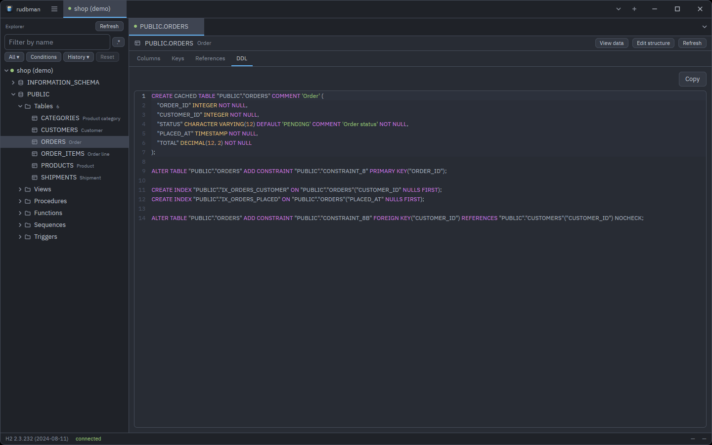

| Tab | Shows |
| --- | --- |
| **Columns** | Column, type, `NULL` / `NOT NULL`, default, `PK`, comment |
| **Keys** | The **Primary key** and the **Indexes**, with uniqueness and order |
| **References** | **Foreign keys of this object** and **Foreign keys pointing at this object**, with their `ON UPDATE` / `ON DELETE` rules |
| **DDL** | The object's `CREATE`, in a read-only, highlighted editor, with **Copy** |

The DDL is the server's own text wherever the product can give it back, and
otherwise rebuilt from the catalog — in which case a line above it says what
the rebuilt text leaves out (check constraints, triggers, partitioning,
collations). Either way it is laid out for reading: one column to a line, a
view's query as Format SQL writes it, a routine's or a trigger's body indented
by block.

Procedures, functions, sequences and triggers get a **Properties** tab — a
routine's parameters and return type, a sequence's start, increment, bounds
and current value, a trigger's table, timing, events and status — and a
**DDL** tab.

In the **Columns** tab, pick rows as in the tree and right-click for **Copy
names** (one per line), **Copy names, comma-separated**, **Copy rows** (the
whole rows as tab-separated text) and **Select all**.

## Queries

### Opening a query tab

- **New query** (<kbd>Ctrl</kbd>+<kbd>T</kbd>) opens an empty query tab on the
  connection in front.
- **Query the selected object** (<kbd>Ctrl</kbd>+<kbd>Enter</kbd> in the
  explorer) opens one with a `SELECT` of the selected object.
- **Open SQL file…** (<kbd>Ctrl</kbd>+<kbd>O</kbd>) reads a `.sql` file into a
  new query tab.
- **Query history…** opens a past statement in a new tab.

### Running statements

| Keys | Runs |
| --- | --- |
| <kbd>Ctrl</kbd>+<kbd>Enter</kbd> | The statement under the caret |
| <kbd>Ctrl</kbd>+<kbd>Alt</kbd>+<kbd>Enter</kbd> | The selection |
| <kbd>Ctrl</kbd>+<kbd>Shift</kbd>+<kbd>Enter</kbd> | Everything in the editor |
| <kbd>Esc</kbd> | Stops the running statement (in the editor or the results) |

**How statements are told apart.** Statements end at a `;`, read the way the
connection's dialect reads them: a `;` inside a string, a comment or a
PostgreSQL `$$` body does not end one. Blank lines do not separate statements,
a last statement needs no `;`, and comments above a statement belong to it.
The statement under the caret is drawn with a band behind it; with the caret
between two statements, the one before it is the one that runs. The `;` itself
is not sent.

- **Run all** reads the editor the way the product's own command-line client
  reads a script, and gives each result set its own tab: MySQL's and
  MariaDB's `DELIMITER`, SQL Server's `GO` (a batch holding a routine or a
  `DECLARE` is sent whole, as `sqlcmd` sends it), Oracle's `/` after a
  PL/SQL unit (a `CREATE PROCEDURE`, a `BEGIN … END` block, a package runs to
  its `/`, or to the end of the editor), Db2's `--#SET TERMINATOR` and
  SQLite's `CREATE TRIGGER … END;`. Commands that only change what the client
  prints — SQL\*Plus's `SET DEFINE OFF`, `PROMPT`, `REM`, psql's `\echo` — are
  skipped, `EXEC` runs as a block, and `EXIT`, `QUIT` or `\q` end the run
  there. A command that cannot be carried out here (`\connect`, `SOURCE`,
  `@file`, `:setvar`, `DEFINE x = …`, `COPY … FROM stdin`) stops the run before
  anything is sent, with its line selected.
- **Run selection** splits the selection on `;` — except that a selection
  holding a procedural block (`DECLARE`, `BEGIN … END`, `CREATE PROCEDURE`
  and the like) is sent whole, so select a routine's whole definition to
  create it, no `DELIMITER` needed. A selection with one of those client lines
  in it (`DELIMITER`, `GO`, `/`, …) is read the way **Run all** reads the
  editor.
- There is no prompt for bind parameters: `?`, `:name` and the like are sent
  as typed.

The toolbar over the editor has, in order: **Run statement**, **Run
selection**, **Run all**, **Explain plan**, **Cancel** · **Commit**,
**Rollback** · **Undo**, **Redo** · **Cut**, **Copy**, **Paste**, **Select
all** · **Toggle comment**, **Format SQL** · **Find…**, **Replace…**. Hover a
button for its shortcut. The editor's right-click menu has the same commands
and **SQL completion**.

A tab runs one thing at a time: a second run while the first is going is
refused rather than queued.

### Results and the result log

Each result set opens a **Result *n*** tab under the editor. **Result log**,
the first tab, records every statement that ran — its SQL, how long it took,
and "Statement executed.", the rows it affected, or the error it stopped at —
and the total time of the run. Right-click a log row for **Copy message** and
**Copy SQL**.

When a single statement fails, the result area shows the driver's message,
its SQLSTATE, and a hint chosen by the kind of error (a syntax or permission
problem, a broken constraint, a lost connection), with **Copy message**.

The status bar counts the rows read across the result tabs — or the rows
affected, when nothing was read — and the time the whole run took.

- The grid fetches rows as you scroll, **Rows per batch** at a time (500
  unless changed in Settings). The status bar reads "500+ rows" while more
  remain, and a grid stops at 200,000 rows with a note that the result has
  more.
- Click a column heading to sort: ascending, descending, then unsorted. A sort
  runs the statement again with `ORDER BY`, since the grid holds only the
  first rows of the answer.
- A statement that changes rows reports how many.
- **A script that fails part way** stops there. The log names which statement
  of how many failed, with its SQL and the error, the results of the
  statements before it stay, and the failed statement is selected in the
  editor.

A result that comes from one table with its whole primary key among the
columns can be edited in place — see [Editing a query result](#editing-a-query-result).

### Transactions

On a profile with **Commit each statement as it runs** on (the default), every
statement commits as it runs, there is nothing to end, and **Commit** and
**Rollback** are grayed out.

With it off, the statements a query tab runs join one open transaction:

- the status bar shows **uncommitted transaction** — its tooltip names the
  query tab the writes came from — and the connection tab wears a dot;
- the editor's **Commit** and **Rollback** buttons are lit:
  <kbd>F11</kbd> commits and <kbd>F12</kbd> rolls back (on macOS
  <kbd>Ctrl</kbd>+<kbd>Cmd</kbd>+<kbd>C</kbd> / <kbd>R</kbd>, since
  <kbd>F11</kbd> is Show Desktop there). A `COMMIT` or `ROLLBACK` run from the
  editor ends the transaction just the same;
- applying edits in a grid, changing a table's structure and transfers on that
  connection are refused, naming the query tab to commit or roll back from,
  rather than committing or discarding your transaction for you;
- closing the connection asks first, because the transaction would be rolled
  back.

### Guarded connections

Two profile switches stand between a statement and a database you would rather
not change by accident.

- **Open the connection read-only** opens the session read-only and refuses a
  write from a query tab without sending it: "This connection is read-only; the
  statement was not sent." Grids and the structure editor show the rows and
  the shape but offer no editing.
- **Ask before running a write statement** puts up **Run this statement?**,
  with the number of statements that change data and the first of them, and
  **Cancel** focused. **Run it** sends them.

A *write* is anything starting with `INSERT`, `UPDATE`, `DELETE`, `MERGE`,
`CREATE`, `ALTER`, `DROP`, `TRUNCATE`, `CALL`, `EXEC`, `GRANT`, `REVOKE`,
`REPLACE`, `UPSERT` or `COPY`, a `SELECT … INTO`, and a `WITH` that writes. A
statement rudbman cannot classify — `BEGIN`, `SET`, a vendor-specific command
— counts as a write too, so a guarded connection errs on the side of asking.

### Explain plan

**Explain plan** (<kbd>Ctrl</kbd>+<kbd>Shift</kbd>+<kbd>E</kbd>, the toolbar,
the editor's right-click menu or the ☰ menu) shows the plan of the selection,
or of the statement under the caret, in a read-only **Plan *n*** tab of up to
10,000 rows. The statement itself is **not run**, and the log says so. A
selection of several statements is refused: select one.

| Product | How the plan is asked for |
| --- | --- |
| PostgreSQL, MySQL, MariaDB, H2 | `EXPLAIN` |
| SQLite | `EXPLAIN QUERY PLAN` |
| Oracle | `EXPLAIN PLAN FOR`, then `DBMS_XPLAN.DISPLAY()` |
| SQL Server | `SET SHOWPLAN_TEXT ON`, the statement, `SET SHOWPLAN_TEXT OFF` |
| Db2 | Not supported: it needs explain tables of its own |
| Any other driver | `EXPLAIN`, and the database's own answer |

A plan is not a write, so a read-only profile and **Ask before running a write
statement** let it through. Two cautions:

- Oracle's `EXPLAIN PLAN` writes into the session's `PLAN_TABLE`, which on a
  manual-commit connection joins the open transaction, and which a read-only
  connection may refuse.
- While SQL Server's option is on, anything else sent on the same connection
  in that moment — another tab's statement, the explorer — is planned rather
  than run. `SHOWPLAN_TEXT OFF` is sent even when the plan fails, and if it
  cannot be sent, rudbman says so in red: reconnect before running anything
  else.

### Completion

Completion opens as you type a word or after a dot, or with
<kbd>Ctrl</kbd>+<kbd>Space</kbd> — <kbd>Ctrl</kbd> on macOS too:
<kbd>↑</kbd> / <kbd>↓</kbd> choose, <kbd>Enter</kbd> or <kbd>Tab</kbd>
inserts, <kbd>Esc</kbd> dismisses. It offers keywords, the dialect's common
functions (`COUNT`, `SUM`, `AVG`, `MIN`, `MAX` and the usual scalar ones), and
the connection's schemas, tables and columns — columns read on demand, and
found through table aliases. Completing a function replaces its name and keeps
the arguments already written. Nothing is offered inside comments and string
literals.

### Format SQL, find and replace, comments

- **Format SQL** (<kbd>Ctrl</kbd>+<kbd>Shift</kbd>+<kbd>F</kbd>) lays out the
  selection, or the whole editor, in the [sqlstyle.guide](https://www.sqlstyle.guide/)
  "river" layout: keywords right-aligned on a river, one column to a line.
- **Find…** (<kbd>Ctrl</kbd>+<kbd>F</kbd>) and **Replace…**
  (<kbd>Ctrl</kbd>+<kbd>H</kbd>) open the find bar over the editor, filled with
  the selection when it is on one line. It searches for plain text as you
  type, counts the matches, and has **Aa** for a case-sensitive search.
  <kbd>F3</kbd> / <kbd>Shift</kbd>+<kbd>F3</kbd> go to the next and previous
  match (also <kbd>Cmd</kbd>+<kbd>G</kbd> / <kbd>Cmd</kbd>+<kbd>Shift</kbd>+<kbd>G</kbd>
  on macOS), <kbd>Ctrl</kbd>+<kbd>Alt</kbd>+<kbd>Enter</kbd> in the bar
  replaces them all, and <kbd>Esc</kbd> closes it.
- **Toggle comment** (<kbd>Ctrl</kbd>+<kbd>/</kbd>) comments or uncomments the
  selected lines with `--`.

The editor highlights SQL as the connection's dialect writes it, handles input
methods for Korean, Japanese and Chinese, keeps a new line's indentation,
indents and outdents with <kbd>Tab</kbd> / <kbd>Shift</kbd>+<kbd>Tab</kbd>, and
wraps long lines when **Wrap long lines in the editor** is on in Settings. Its
text size is **Editor size** in Settings.

### SQL files

- **Save SQL file** (<kbd>Ctrl</kbd>+<kbd>S</kbd>) writes the tab to the file
  it was opened from or last saved to. The first time, it asks where,
  suggesting the tab's name with today's date after it — or before it, or
  left out, as **SQL file name date** in Settings says. A name typed without
  an extension is saved as `.sql`.
- **Save SQL file as…** (<kbd>Ctrl</kbd>+<kbd>Shift</kbd>+<kbd>S</kbd> on Linux
  and Windows) always asks.
- The tab takes the file's name, and a dot after it marks changes not yet
  saved.
- A file changed on disk since the tab read or saved it — by another program,
  or by another tab — is never overwritten in place: the save asks where
  instead.

### Query history

Every statement a query tab runs because you asked it to is recorded for the
connection's profile: when it ran, how long it took, and the rows it returned,
the rows it changed, or the error it stopped at. Sort re-runs, grid applies,
plans and writes that were refused or declined are not recorded.

**Query history…** (<kbd>Ctrl</kbd>+<kbd>Shift</kbd>+<kbd>H</kbd>, the ☰ menu
or a connection tab's menu) lists them newest first, with the whole statement
under the list:

- type to search; <kbd>↑</kbd> / <kbd>↓</kbd> move;
- <kbd>Enter</kbd> or a double-click opens the statement in a **new query
  tab**, without running it;
- **Copy SQL**, **Delete** and **Clear history…** are beside it and on a row's
  right-click menu.

Each profile keeps up to 1,000 statements and 4 MiB of SQL, oldest dropped
first; a statement over 256 KiB is not recorded. The history is plain JSON in
the configuration directory, and statements can carry secrets: **Keep a
history of the statements query tabs run** in [Settings](#database) turns
recording off (what was recorded stays until it is deleted).

## Table data

### The data tab

**View data** — from the explorer's menu or the detail panel — opens a table's
rows in a data tab, one per table. It reads them as you scroll, like a query
result, and stops at 200,000 rows. **Refresh** (<kbd>F5</kbd>) reads them
again; **Cancel** stops a load or a sort that takes too long.

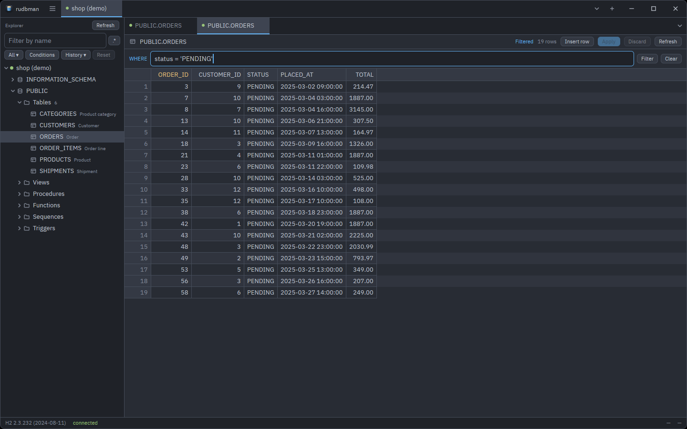

Click a column heading to sort by it: the rows are read again in that order,
with the primary key as a tie-breaker. The header's right-click menu also has
**Fit to contents**, **Hide this column**, **Show all columns** and **Copy
column name**.

### Filtering rows

The **WHERE** strip under the toolbar reads the rows again under a condition:

1. Type a condition such as `status = 'PENDING'` (<kbd>Ctrl</kbd>+<kbd>F</kbd>
   puts the keyboard there).
2. Press <kbd>Enter</kbd> or **Filter**. **Filtered** beside the row count
   says the rows are not all of them.
3. <kbd>Esc</kbd> or **Clear** brings every row back.

A leading `WHERE` and a trailing `;` are taken off, and a second statement
after the condition is refused. A condition the database rejects is reported
like any failed load and stays in the field to be corrected. The filter is kept
with the workspace and copied by a split.

### Editing rows

A table can be edited when it has a primary key and the profile is not
read-only; otherwise a line above the grid says why its rows can be read but
not changed. Views usually report no primary key, so their rows are read-only.
Columns the driver reports as read-only or auto-incremented cannot be edited.

| To | Do |
| --- | --- |
| Edit a cell | Double-click it, press <kbd>F2</kbd> or <kbd>Enter</kbd>, or start typing. <kbd>Enter</kbd> keeps the value, <kbd>Esc</kbd> cancels, <kbd>Tab</kbd> moves on. |
| Set a cell to `NULL` | **Set to NULL**, <kbd>Ctrl</kbd>+<kbd>0</kbd> or <kbd>Shift</kbd>+<kbd>Delete</kbd>. Emptying a field stores an empty string, not `NULL`. |
| Add a row | **Insert row** or <kbd>Alt</kbd>+<kbd>Insert</kbd>. Cells you leave alone read *DEFAULT* and are left out of the `INSERT`, so the server fills them. |
| Delete rows | <kbd>Delete</kbd> (and <kbd>Backspace</kbd> on macOS) marks the selected rows; pressed again, it unmarks them. |
| Paste | <kbd>Ctrl</kbd>+<kbd>V</kbd> pastes tab-separated cells from the cursor on, or one value into every selected cell. |
| Undo a row | **Discard this row's changes**, or **Restore row** on a deleted one. |
| Undo everything | **Discard**, which asks first. |

Nothing reaches the database until you apply. The toolbar counts what is
staged — "2 changed · 1 inserted · 1 deleted" — and while anything is, a sort,
a refresh or a new filter waits for it to be applied or discarded.

### Applying changes

**Apply** (<kbd>Ctrl</kbd>+<kbd>S</kbd>) always shows the statements first,
each with the values it binds. **Apply** there runs them:

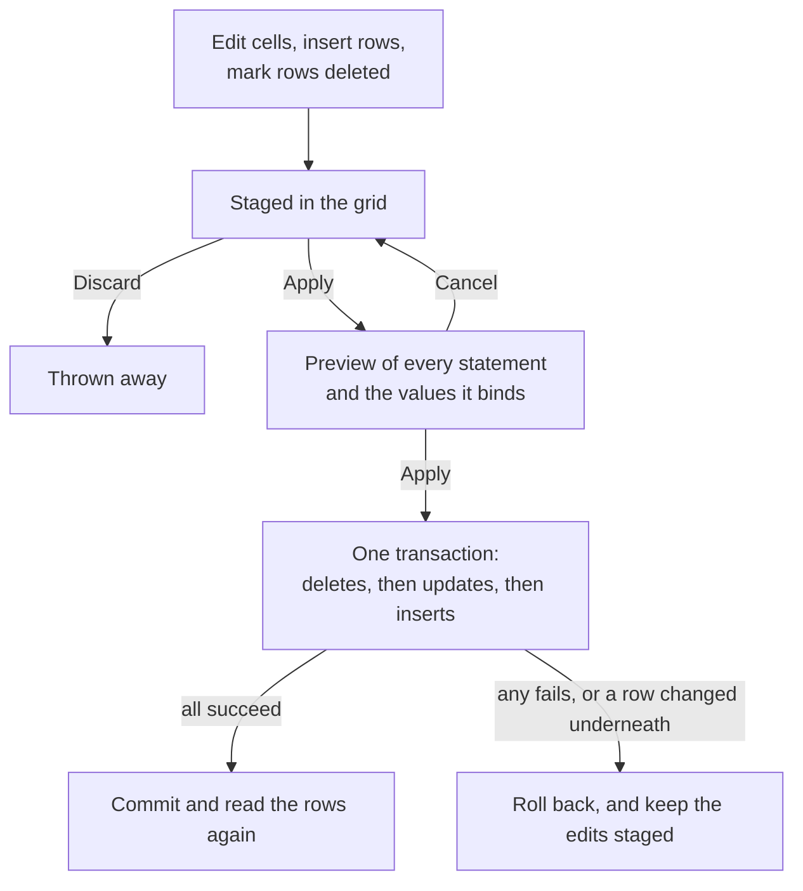

- Every `UPDATE` and `DELETE` finds its row by the primary key alone, and must
  touch exactly one row. If one touches none or several — somebody else
  changed or deleted the row — the whole batch is rolled back and nothing is
  applied.
- A value that cannot be written to its column (`abc` into an integer) is
  refused before anything is sent.
- On a product without transactions the preview says so in red, because a
  failure part way cannot be undone.
- Apply is refused while a query tab on the connection holds an uncommitted
  transaction.

### Editing a query result

A query result can be edited like a data tab when its rows come from **one
table** and **every column of its primary key** is among the selected columns.
The rows appear at once; the grid becomes editable a moment later, once the key
has been looked up. Otherwise a line above the grid says the rows can be read
but not changed.

A query result takes **updates and deletes**, never inserts: a row typed into
`SELECT id, name` would miss every column not selected, and need not satisfy
the query's own `WHERE`. Inserting is what the table's data tab is for. Apply
and Discard sit on the result tab strip, Apply uses the same preview and
transaction, and the statement runs again afterwards.

### LOB and multiline values

Double-click a BLOB or CLOB cell (including a `NULL` one), or choose **Open
LOB…** from its menu. A text cell that holds line breaks shows its first line
with visible `\n` separators, and opens the same viewer with **Open text
editor…**.

- A CLOB or text value is edited as text, and files are read and written as
  UTF-8. A BLOB is edited as hexadecimal byte pairs, 16 to a line.
- **Save to file…** writes the complete value. **Replace from file…** takes
  a replacement without changing the database yet. **Empty value** and **Set
  to NULL** are kept apart, because the database tells them apart.
- **Add to changes** (<kbd>Ctrl</kbd>+<kbd>Enter</kbd>) stages the value; the
  grid's **Apply** writes it, with the same preview and transaction.
- Only the first 1 MiB of a larger value is shown, read-only; it can still be
  saved whole, and replaced from a file without being loaded into the editor.
- A read-only result can still be viewed and saved.

Copying and writing keep the real line breaks of a multiline value.

### Copying from the grid

Select cells with the mouse or the keyboard (<kbd>Ctrl</kbd>+<kbd>A</kbd>
selects all) and right-click:

| Row | Copies |
| --- | --- |
| **Copy as TSV** (<kbd>Ctrl</kbd>+<kbd>C</kbd>) | Tab-separated values, no header, `NULL` as an empty field |
| **Copy as CSV** | Comma-separated values, quoted where needed |
| **Copy as JSON** | An array of objects keyed by column name, `NULL` as `null` |
| **Copy as INSERT** | One `INSERT` per row, into the table the rows come from |

## Table structure

### Editing a table's structure

**Edit structure** — from the explorer's menu or the detail panel — opens a
table's columns and constraints in a pane that writes `ALTER TABLE` for you.

- **Columns** lists every column with its type, nullability, default and
  state. Pick one and change it in the **Selected column** form under the
  list: **Name**, **Type**, **Default** with **Has a default**, and **NOT
  NULL**. A type or a default is your own SQL, passed through as typed.
- **Add column** adds one; **Drop** marks an existing one to be dropped
  (**Keep** takes the mark off), and **Remove** takes back an added one.
- **Constraints** lists the primary key, unique constraints and foreign keys,
  each of which can be dropped.
- **Rename table** gives the table a new name in the same schema.
- **Statements** shows the batch your changes would send, recomputed as you
  type, or — in red — why a change cannot be written for this product.

**Apply** shows the statements and runs them. Unlike a data edit, a structure
change cannot be rolled back: several products commit at every DDL statement
whatever the client asks, so rudbman runs the batch with auto-commit on, stops
at the first statement that fails, and says how many before it were committed.
Either way, the pane then reads the table again.

### Creating a table

**New table** — on a schema, a catalog or a Tables folder — opens the same pane
in create mode, titled "New table in *schema*":

1. Give the **Table name**.
2. **Add column** for each column, filling in the form.
3. Under **Add a constraint**, pick **PRIMARY KEY**, **UNIQUE** or **FOREIGN
   KEY**, tick the columns in the order you want them, optionally name it,
   and for a foreign key give the **Referenced table** (and its columns, or
   leave them empty for its primary key). **Add constraint** stages it.
4. **Create table**.

Creating a table is the one place a constraint is born: once the table exists,
the pane can drop constraints but not add them. A create that fails keeps what
you typed. One that succeeds turns the pane into the structure editor of the
new table and refreshes the schema in the explorer.

### What each database cannot do

What a product cannot express is refused by name before anything is sent,
rather than sent and rejected:

- **SQLite** can add, drop and rename columns and rename the table — nothing
  else. A changed type, nullability or default would need the table rebuilt,
  and constraints cannot be dropped.
- **SQL Server** keeps a default as a separately named constraint the catalog
  does not report, so an existing column's default cannot be changed here.
- **MySQL and MariaDB** need a new foreign key's referenced columns spelled
  out.
- **Db2** puts a table into *reorg pending* after a changed type or
  nullability or a dropped column; rudbman ends such a batch with
  `CALL SYSPROC.ADMIN_CMD('REORG TABLE …')` so the table takes writes again.

Not supported anywhere: adding a constraint or an index to an existing table,
dropping a table, reordering columns, and check constraints.

## ERD diagrams

**ERD diagram** (<kbd>Ctrl</kbd>+<kbd>E</kbd> in the explorer, or the menus)
draws every table of the schema or catalog the selection sits in, joined by
their foreign keys, in a tab named "ERD — *schema*". Asked for again, the open
diagram comes to the front.

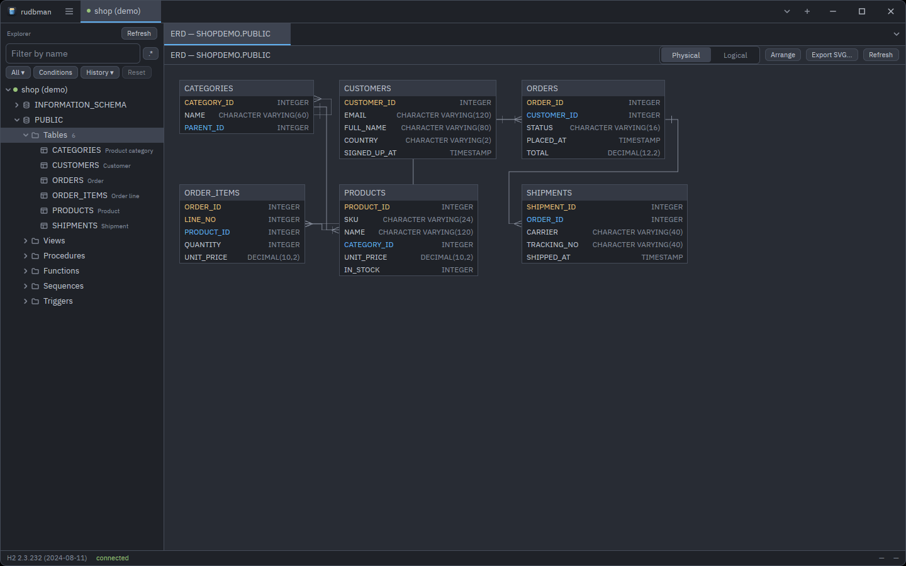

- Each box lists the table's columns with their types; primary-key columns
  and foreign-key columns are drawn in colors of their own. Views are not
  drawn, and a foreign key to a table outside the schema has no line.
- A large schema says how many tables' keys have been read, with **Cancel**;
  **Refresh** starts it again.
- Tables are placed by a hierarchical layout and joined by routed,
  right-angled lines. Drag a table to move it: the position is saved for the
  profile and the schema, and comes back next time. **Arrange**
  (<kbd>Ctrl</kbd>+<kbd>Shift</kbd>+<kbd>A</kbd>) lays everything out again.
- **Physical** / **Logical** switches the boxes between the names and the
  comments the catalog carries (<kbd>Ctrl</kbd>+<kbd>Shift</kbd>+<kbd>L</kbd>).
  The choice is kept for the next diagram.
- Drag the background to pan; the wheel scrolls, <kbd>Shift</kbd>+wheel
  scrolls sideways and <kbd>Ctrl</kbd>+wheel zooms.
  <kbd>Ctrl</kbd>+<kbd>=</kbd> / <kbd>-</kbd> / <kbd>0</kbd> zoom in, out and
  back to actual size.
- **Export SVG…** writes the diagram to a file.
- Right-click a table for **Open details**, which opens its detail panel; the
  canvas's menu also has **Arrange**, **Logical names**, the zoom commands,
  **Export SVG…** and **Refresh**.

## The query builder

**New query builder** (the ☰ menu or a connection tab's menu) opens an empty
canvas, **Builder *n***. **Add to query builder** on a table or view puts it
on the builder in front, or the first one open, opening one if there is none.
You can also drag tables and views from the explorer onto the canvas.

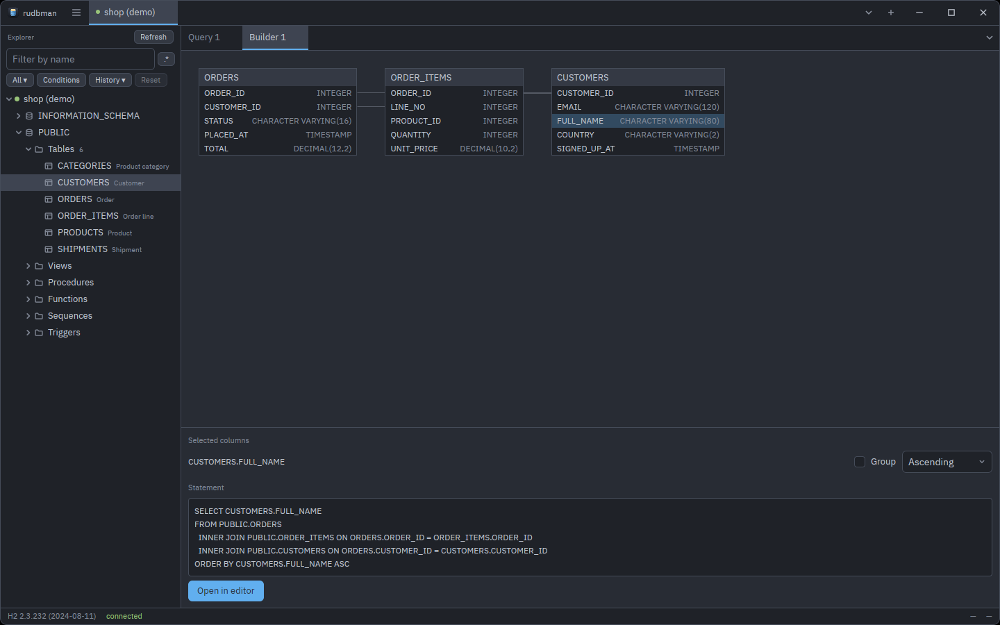

- **Drag a table by its title** to move it. A table added twice gets an alias
  (`ORDERS_2`), which is how a self-join is built.
- **Click a column** on the canvas to add it to the select list, or click it
  again to take it out. With nothing picked, the statement is `SELECT *`.
- **Drag a column onto a column of another table** to join them, or pick the
  two columns in the **Joins** form, which appears once two tables are on the
  canvas, and press **Add join**. A join starts as **INNER JOIN** and can be
  changed to **LEFT JOIN**, **RIGHT JOIN** or **FULL JOIN**. Tables with no
  join between them are listed with a comma.
- **Conditions** takes `WHERE` conditions as text (`id > 1000`), combined with
  `AND`.
- Under **Selected columns**, each column can be grouped (**Group**) and
  sorted (**Unsorted**, **Ascending**, **Descending**).
- **Statement** previews the `SELECT` as you go, with identifiers quoted as
  the dialect wants them. **Open in editor** sends it to a new query tab,
  without running it.
- Right-click a table for **Remove table**, which takes its joins and picked
  columns with it, and a column for **Add to the select list** / **Remove from
  the select list**.

The builder writes plain selects: aggregates, `DISTINCT`, row limits and
column aliases are added in the editor afterwards. The canvas and the form say
which gesture to use until each has been used. Builders — tables, positions,
joins, columns and conditions — are kept with the workspace.

## Extracting a script

**Extract script…** on a table or view (the explorer's menu or the ☰ menu)
writes it out to a file. The form starts from its defaults each time.

| Option | Default | Notes |
| --- | --- | --- |
| **Output file** | — | **Browse…** picks it, suggesting `<table>.sql` (or `.csv`). The folder is remembered, and shared with backups and SVG exports. |
| **Include the definitions (DDL)** | on | The `CREATE`, with its foreign keys as `ALTER TABLE` at the end. |
| **Precede it with DROP statements** | off | Under the DDL option. |
| **Include the rows** | on | In the **Row format** below. |
| **Row format** | INSERT statements | **INSERT statements**, **CSV** or **Template**. |
| **Rows per INSERT** | 1 | For INSERT statements: how many rows one `INSERT` carries. Always 1 on Oracle. |
| **Template file** | — | For **Template**: a file of your own. |
| **WHERE clause** | — | Narrows the rows, without the `WHERE` keyword. |

The file is UTF-8 with `\n` line endings. **CSV** is comma-separated with a
header row of column names; a field is quoted when it holds a comma, a quote
or a line break, `NULL` is an empty field and an empty string is `""`. A SQL
script — one with DDL or `INSERT`s — opens with the session settings the
product's client needs (`SET FOREIGN_KEY_CHECKS = 0` on MySQL and MariaDB,
`SET QUOTED_IDENTIFIER ON` on SQL Server); rows alone as CSV or through a
template get none.

**Extract** streams the rows to the file from inside the Java runtime, so a
large table does not pass through the window, with a progress card counting
rows and bytes. <kbd>Esc</kbd> asks whether to stop. The file is written beside
its final name and renamed only when the extraction finishes, so a canceled or
failed one leaves whatever was there before untouched.

### Templates

A template is a text file rendered **once per row**, the results written one
after another — a way to turn rows into anything from Java classes to
configuration lines. The row's values are available by column name, and with
the table around them:

| Name | Value |
| --- | --- |
| `${COLUMN_NAME}` | The row's value of that column |
| `${table}`, `${schema}`, `${catalog}`, `${qualified}` | Where the row comes from |
| `${row_no}` | The row's number |
| `columns` | A list of the row's columns, each with `name`, `value`, `literal` (the value as an SQL literal), `type_name` and `jdbc_type` |
| `${user}`, `${author}`, `${date:yyyy-MM-dd}` | Who and when |

A column whose name clashes with a fixed key (a column called `table`) wins,
and the loop is then the way to reach both. Inside a loop, a bare name such as
`${name}` reads off the current item.

The template language is jdbgen's, the one the sibling tool rudbgen uses too;
its [template reference](https://github.com/xcomart/rudbgen/blob/main/docs/template-reference.md)
describes the language in full, though its model — tables rather than rows —
is rudbgen's own. In short:

| Construct | Example |
| --- | --- |
| A value | `${NAME}`, or `${item:key=NAME,padSize=10,padDir=right}` to pad it |
| A loop | `${for:item=columns,inStr=", "}${name}${endfor}` — `inStr` goes between items |
| A condition | `${if:key=STATUS,equals=PAID}…${elif:key=STATUS,equals=SHIPPED}…${else}…${endif}` |
| Text processors | `${table.camel}`, `${table.pascal}`, `${table.snake}`, `${table.kebab}`, `${table.lower}`, `${table.upper}` |
| A literal | `${"text"}` |

Conditions also take `notEquals`, `contains`, `startsWith`, `endsWith` and
`matches`, and their `not…` forms. A template that renders one `INSERT` per
row in a format of your own, for example — end it with a line break, or the
rows run together:

```text
INSERT INTO archive.${table.lower} (${for:item=columns,inStr=", "}${name}${endfor}) VALUES (${for:item=columns,inStr=", "}${literal}${endfor});
```

## Backing up a schema

**Back up schema…** — on any node inside a schema, or from the ☰ menu — writes
the whole schema (or catalog) the selection sits in to a `.sql` script that can
be replayed to rebuild it, at the level of a schema dump. The form starts from
its defaults each time.

| Option | Default | Notes |
| --- | --- | --- |
| **Output file** | — | **Browse…** picks it, suggesting `<schema>_backup_<yyyyMMdd>.sql` (`.sql.gz` with gzip), dated with today's date. |
| **Compress the file with gzip** | off | |
| **Include the definitions (DDL)** | on | The tables, with **Precede it with DROP statements** (off) under it. |
| **Also include** | all on | **Sequences**, **Views**, **Procedures and functions**, **Triggers**. |
| **Include the rows** | on | As `INSERT` statements. |
| **Rows per INSERT** | 1 | How many rows one `INSERT` carries. |

The file's first line is a comment naming the scope it was taken of —
`-- rudbman backup: {"schema":"APP"}` — which every product's client passes
over, and which a restore into another schema reads to know which names to
move.

The script runs in this order: the product's session settings, the drops,
PostgreSQL's extensions, enums and domains, sequences, tables, routines (and
Oracle packages), views, the rows, the foreign keys, the identity and sequence
counters, materialized views, and triggers.

- Tables get the server's own `CREATE TABLE` wherever the product can give it
  back (MySQL, MariaDB, H2, Oracle, SQLite), and one rebuilt from the catalog
  elsewhere.
- Rows are ordered so that a parent's rows come before its children's, by a
  topological sort of the foreign keys, and the foreign keys are added after
  the rows.
- Identity and sequence counters are carried over, so new rows do not collide
  with restored ones.
- Routine and trigger bodies are written the way each product's own client
  reads a script: between `DELIMITER ;;` lines for MySQL and MariaDB, ended by
  `/` for Oracle (whose script starts with `SET DEFINE OFF`), followed by `GO`
  for SQL Server, and under `--#SET TERMINATOR @` for Db2.

**Back up** shows progress — the byte count is what reached the file, after
compression — and can be stopped with <kbd>Esc</kbd>, which leaves nothing
behind. Objects whose definition could not be read are left out and named when
it finishes.

## Restoring from a script

**Restore from script…** — on any node inside a schema, or from the ☰ menu —
runs a `.sql` or `.sql.gz` file against the schema (or catalog) the selection
sits in. Names the script leaves unqualified land there: the restore starts
with `USE` on MySQL, MariaDB and SQL Server, and sets the current schema on
the others.

The script is read the way the product's own command-line client reads one,
by the rules **Run all** follows (see [Running statements](#running-statements)),
so these all restore as they would from their client:

- a backup written by **Back up schema…**;
- `pg_dump` in plain format with `--inserts` (its default `COPY … FROM stdin`
  is refused; a custom-format archive is recognized and refused too — restore
  that one with `pg_restore`);
- `mysqldump` and `mariadb-dump`, with routines and triggers between their
  `DELIMITER ;;` lines — with `--hex-blob` when a table has binary columns,
  which otherwise go into the dump as raw bytes;
- an SSMS "Generate Scripts" script, `GO` batches and all, saved as UTF-8 or
  as Unicode (UTF-16);
- a SQL Developer export, with its `SET DEFINE OFF`, `REM` lines and slashes;
- `sqlite3`'s `.dump` and H2's `SCRIPT`.

| Option | Default | Notes |
| --- | --- | --- |
| **Script file** | — | **Browse…** picks it. Gzip is told by the file's contents, not its name. |
| **Restore the objects of … into …** | on | Shown when the script names its objects in a scope other than the selected one. |
| **Continue past failed statements** | off | Off, the first failure ends the run; on, failures are counted and the first of them listed at the end. |

**Into another schema.** Choosing the file reads it through, and the dialog
says how many statements it holds and which schema (or database) its objects
are named in: a backup says so on its first line, and any other script is read
for where its statements create and fill things. A backup names them in full — `"APP"."PARENT"`, `USE shop` — so
when that is not the selected scope (a backup of `APP` restored from the menu
of `ARCHIVE`), **Restore the objects of APP into ARCHIVE** is offered, ticked.
It rewrites the script's qualified names, its `USE` and `CREATE SCHEMA`, and
the names it passes to a function as a string — `nextval('app.seq')`,
`COMPILE_SCHEMA('APP')`, `DBCC CHECKIDENT`, `sp_addextendedproperty` — into
the selected scope, routine bodies and MySQL's `/*! … */` included; every
other string, comments among them, is data and stays as written. Untick it to
restore where the script names them. A script that names several schemas is
restored as written. The selected scope exists, so the script's
`CREATE SCHEMA` or `CREATE DATABASE` of it — `pg_dump -n` writes one — is
passed over.

> A PostgreSQL extension exists once per database. A schema whose functions
> come from an extension installed in it (`CREATE EXTENSION … WITH SCHEMA
> app`) cannot be copied to another schema of the same database: the copy
> still needs those functions in its own schema.

The file is read through once more before anything runs: a line the restore
cannot carry out, or text that is not UTF-8 or UTF-16, stops it there with
nothing changed. Then every statement runs on a session of its own, opened beside the
connection's with the same login, under auto-commit — so the `SET`s, `USE`s
and `search_path` a dump changes do not reach the query tabs, and the
explorer stays usable while it runs. Progress counts statements and bytes;
<kbd>Esc</kbd> asks whether to stop, and what already ran stays. A read-only
connection does not restore.

## Transferring rows

**Transfer rows…** on a table or view (the explorer's menu or the ☰ menu)
copies its rows into a table on another open connection — or into another
table on the same one. Open the target connection first.

| Option | Default | Notes |
| --- | --- | --- |
| **Source object** | — | The table the dialog was opened over. |
| **Target connection** | Another open connection | The last target, while it is still open; otherwise the first open connection that is not the source's. |
| **Target schema** | The source's schema | Blank is wherever the target connection points. |
| **Target table** | The source's name | It must already exist: a transfer creates no table. |
| **Write mode** | Insert every row | **Insert every row**; **Insert, or update the row already there**; or **Empty the target table first**. |
| **WHERE clause** | — | Narrows the source rows, without the `WHERE` keyword. |
| **On a row that will not go in** | Stop the transfer | **Stop the transfer**, **Skip the row**, or **Skip the row and record why**. |

- Columns are matched by name: the source's column names are the target's.
- **Insert, or update the row already there** is an upsert, written as the
  target dialect spells it — `MERGE`, `ON CONFLICT` or `ON DUPLICATE KEY` — and
  needs a primary key on the target table.
- **Empty the target table first** replaces the buttons with a question saying
  how many rows of which table will be deleted, and **Empty and transfer**. The
  rows are deleted with `DELETE`, not `TRUNCATE`.
- Rows go in batches of 500, committed every 10,000 rows. When rows may be
  skipped, each batch is fenced with a savepoint and replayed a row at a time
  on a failure, so one bad row does not cost the rest of its batch.
- A transfer of a table into itself is refused, and so is a transfer into a
  connection whose query tab holds an uncommitted transaction.
- Progress counts the rows copied and, once any are, the rows skipped.
  <kbd>Esc</kbd> asks whether to stop; a canceled transfer keeps the rows
  already committed, and says how many.
- With **Skip the row and record why**, the finished card lists why rows
  would not go in, in the target driver's words — the first five, and how many
  more were skipped. **Skip the row** only counts them.
- The target, the write mode and the policy are remembered until rudbman
  quits — except **Empty the target table first**, which has to be chosen
  again each time.

## Settings

<kbd>Ctrl</kbd>+<kbd>,</kbd>, or **Settings…** in the ☰ menu (the rudbman menu
on macOS), opens the settings dialog. Themes, fonts and sizes preview as you
change them and **Cancel** puts them back; everything else applies on
**Save**.

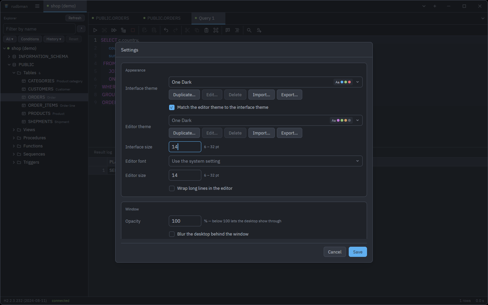

### Appearance

| Setting | Values | Notes |
| --- | --- | --- |
| **Interface theme** | One Dark, One Light, Solarized Dark, Solarized Light, Gruvbox Dark, Dracula, and your own | One Dark by default. |
| **Match the editor theme to the interface theme** | on/off | On by default: the editor follows the interface theme. |
| **Editor theme** | The same six, and your own | Chosen here when the switch above is off. |
| **Interface size** | 6–32 pt | 14 by default. Scales the whole chrome — text, buttons, icons, rows, tab strips, toolbar, status bar and dialogs. |
| **Editor font** | Use the system setting, or any installed family | The system default is a monospaced font of the platform's. |
| **Editor size** | 6–32 pt | 14 by default. Also the result grids' font size. |
| **Wrap long lines in the editor** | on/off | Off by default. |

### Window

| Setting | Values | Notes |
| --- | --- | --- |
| **Opacity** | 50–100 % | 100 by default. Below 100 the desktop shows through. |
| **Blur the desktop behind the window** | on/off | Where the platform supports it. |
| **Title bar** | Drawn by rudbman, Drawn by the system | Drawn by rudbman by default: the tab strip is the title bar. |

### Language

**Interface language** is **Use the system setting** or one of eight languages:
Deutsch, English, Español, Français, 日本語, 한국어, Русский, 简体中文. Menus and
dialogs change as soon as the settings are saved. Driver error messages follow
the language from the next start, since the Java runtime takes it when it
starts.

### Database

| Setting | Values | Notes |
| --- | --- | --- |
| **Rows per batch** | 1–100,000 | 500 by default. How many rows a grid fetches at a time as it is scrolled. Applies to tabs opened afterwards. |
| **Statement timeout** | seconds | 0 by default: no limit. How long a statement a query tab runs may take — each page of a result read a page at a time included — before the driver stops it as canceled. Applies from the next run, in tabs already open too. |
| **Connection timeout** | 0–600 seconds | 30 by default; 0 leaves it to the driver. Applies to the next connect. |
| **Ask before running a write statement on a new connection** | on/off | On by default. The starting value of the profile switch for profiles made afterwards. |
| **Keep a history of the statements query tabs run** | on/off | On by default. See [Query history](#query-history). |
| **SQL file name date** | after the name / before the name / none | After the name by default: `Query 1_20261114.sql`. Before it gives `20261114_Query 1.sql`, none gives `Query 1.sql`. Only the name suggested the first time a tab is saved; see [SQL files](#sql-files). |

### Java virtual machine

| Setting | Values | Notes |
| --- | --- | --- |
| **Java heap** | MB, at least 128 | 1024 by default. The `-Xmx` the drivers run under. |
| **Extra arguments** | Separated by spaces | Added after rudbman's own options. |

Both take effect the next time rudbman starts, because the Java runtime starts
once per run. A query that runs out of memory fetching a large result usually
wants a larger heap.

### Themes

Under each theme picker, a row of buttons manages the themes:

| Button | What it does |
| --- | --- |
| **Duplicate…** | Copies the selected theme, a built-in one included, into a file of your own named "… (copy)", and opens it for editing. |
| **Edit…** | Opens a theme of your own in the color editor. Grayed out for the built-in six. |
| **Delete** | Removes a theme of your own, after asking. |
| **Import…** | Reads theme files from anywhere into the right folder. A file of the other kind is refused with the row to import it under. |
| **Export…** | Writes the selected theme, built-in ones included, to a file. |

The color editor shows each color as a `#RRGGBB` field with a swatch and a
live preview; **Save** writes the file and applies it at once. An interface
theme's five **Result grid** colors may be left empty, and are then derived
from the rest of the palette.

Themes are JSON files in the `themes` and `editor-themes` folders of the
configuration directory; a file's name is the theme's id. The folders are read
at start-up, so a file copied in by hand appears after a restart.

### settings.json

Settings are kept in `settings.json` in the configuration directory, which can
be edited by hand while rudbman is not running:

- missing keys take their defaults, and keys rudbman does not know are kept;
- out-of-range numbers are brought into range rather than refused;
- writes are atomic: a temporary file is written and renamed over the old one;
- the file is read once, at start-up, and written when settings are saved and
  when the window closes (with its size and position), so an edit made while
  rudbman runs is overwritten;
- a file that cannot be read at start-up is never overwritten: rudbman runs on
  the defaults, and the dialog refuses to save until a restart reads the file.

## Updating

rudbman asks GitHub once per launch, in the background, whether a newer release
has been published. Nothing waits for the answer, and any failure stays silent;
the only visible outcome is the update dialog when there is something newer.
**Check for updates** in the ☰ menu (the rudbman menu on macOS) asks on demand
and answers either way.

The dialog names the version on offer and the one running, shows the release
notes under **What's new**, and offers:

| Answer | What happens |
| --- | --- |
| **Update and restart** | Downloads this platform's build, checks it against its published SHA-256, installs it in place of the running copy, and restarts — after the same question quitting asks when there is work to lose. |
| **Ignore this version** | This release is not announced again. A later one is. |
| **Cancel** | Nothing happens; the next launch asks again. |

Nothing is elevated and nothing is written outside the folder rudbman is
installed in. A copy that cannot be overwritten — a read-only location, a
system package — fails with **Open the release page**, which is also what
**Update and restart** does on a platform without a published build. Builds are
published for x86-64 Windows, Apple Silicon macOS and x86-64 Linux.

## Keyboard shortcuts

The ☰ menu's **Keyboard shortcuts** shows the main ones in the app, with the
chords of the platform it runs on, and a **User guide** button that opens this
page. On macOS read <kbd>Cmd</kbd> for <kbd>Ctrl</kbd>, except where a row says
otherwise; the pane chords use <kbd>Alt</kbd> on Linux and Windows and
<kbd>Cmd</kbd> on macOS.

| Where | Keys | Does |
| --- | --- | --- |
| Window | <kbd>Ctrl</kbd>+<kbd>N</kbd> | Manage connections (in the connection dialog: new profile) |
| | <kbd>Ctrl</kbd>+<kbd>,</kbd> | Settings |
| | <kbd>Ctrl</kbd>+<kbd>Shift</kbd>+<kbd>H</kbd> | Query history of the connection on screen |
| | <kbd>Ctrl</kbd>+<kbd>B</kbd> | Show or hide the explorer |
| | <kbd>Ctrl</kbd>+<kbd>Q</kbd> | Quit (asks first when something would be lost) |
| | <kbd>F10</kbd> | Open the ☰ menu (Linux and Windows) |
| | <kbd>Shift</kbd>+<kbd>F10</kbd>, <kbd>Menu</kbd> | Open the context menu of what has the keyboard |
| | <kbd>Esc</kbd> | Close the topmost dialog or menu |
| Tabs | <kbd>Ctrl</kbd>+<kbd>T</kbd> | New query tab |
| | <kbd>Ctrl</kbd>+<kbd>W</kbd> | Close the tab on top (Linux and Windows) |
| | <kbd>Ctrl</kbd>+<kbd>Shift</kbd>+<kbd>T</kbd> | Reopen the query or builder tab closed last |
| | <kbd>Ctrl</kbd>+<kbd>PgDn</kbd> / <kbd>PgUp</kbd>, <kbd>Ctrl</kbd>+<kbd>Tab</kbd> / <kbd>Ctrl</kbd>+<kbd>Shift</kbd>+<kbd>Tab</kbd> | Next / previous tab of the pane (macOS: <kbd>Cmd</kbd>+<kbd>Alt</kbd>+<kbd>→</kbd> / <kbd>←</kbd>) |
| | <kbd>Ctrl</kbd>+<kbd>1</kbd>–<kbd>8</kbd>, <kbd>Ctrl</kbd>+<kbd>9</kbd> | That tab, the last tab |
| | <kbd>Ctrl</kbd>+<kbd>Alt</kbd>+<kbd>PgDn</kbd> / <kbd>PgUp</kbd> | Next / previous connection tab (Linux and Windows) |
| Panes | <kbd>Alt</kbd>+<kbd>Shift</kbd>+<kbd>D</kbd> / <kbd>S</kbd> | Split right / below |
| | <kbd>Alt</kbd>+<kbd>W</kbd> | Close the pane |
| | <kbd>Alt</kbd>+<kbd>]</kbd> / <kbd>[</kbd> | Next / previous pane |
| | <kbd>F6</kbd> / <kbd>Shift</kbd>+<kbd>F6</kbd> | Explorer → editor → results, and back |
| Files | <kbd>Ctrl</kbd>+<kbd>O</kbd> | Open a `.sql` file |
| | <kbd>Ctrl</kbd>+<kbd>S</kbd> / <kbd>Ctrl</kbd>+<kbd>Shift</kbd>+<kbd>S</kbd> | Save the query tab / save as (no save-as chord on macOS) |
| Explorer | <kbd>Ctrl</kbd>+<kbd>Enter</kbd> | Query the selected object |
| | <kbd>Ctrl</kbd>+<kbd>E</kbd> | ERD of the selection's schema |
| | <kbd>Ctrl</kbd>+<kbd>C</kbd> | Copy the names of the selected rows |
| | <kbd>Shift</kbd>+<kbd>↑</kbd> / <kbd>↓</kbd> | Select a run of rows |
| | <kbd>Ctrl</kbd>+<kbd>F</kbd> | Filter the tree by name |
| | <kbd>Alt</kbd>+<kbd>R</kbd> | In the filter box: read it as a regular expression, or as names again |
| SQL editor | <kbd>Ctrl</kbd>+<kbd>Enter</kbd> | Run the statement under the caret |
| | <kbd>Ctrl</kbd>+<kbd>Alt</kbd>+<kbd>Enter</kbd> | Run the selection |
| | <kbd>Ctrl</kbd>+<kbd>Shift</kbd>+<kbd>Enter</kbd> | Run everything |
| | <kbd>Esc</kbd> | Stop the running statement |
| | <kbd>F11</kbd> / <kbd>F12</kbd> | Commit / roll back (macOS: <kbd>Ctrl</kbd>+<kbd>Cmd</kbd>+<kbd>C</kbd> / <kbd>R</kbd>) |
| | <kbd>Ctrl</kbd>+<kbd>Shift</kbd>+<kbd>F</kbd> | Format SQL |
| | <kbd>Ctrl</kbd>+<kbd>Shift</kbd>+<kbd>E</kbd> | Explain plan |
| | <kbd>Ctrl</kbd>+<kbd>Space</kbd> | Completion |
| | <kbd>Ctrl</kbd>+<kbd>F</kbd> / <kbd>Ctrl</kbd>+<kbd>H</kbd> | Find / replace |
| | <kbd>Ctrl</kbd>+<kbd>/</kbd> | Toggle comment |
| Data grid | <kbd>Delete</kbd> (macOS: also <kbd>Backspace</kbd>) | Mark the selected rows for deletion, or unmark them |
| | <kbd>F2</kbd>, or start typing | Edit the cell |
| | <kbd>Ctrl</kbd>+<kbd>V</kbd> | Paste |
| | <kbd>Ctrl</kbd>+<kbd>0</kbd>, <kbd>Shift</kbd>+<kbd>Delete</kbd> | Set the cell to `NULL` |
| | <kbd>Alt</kbd>+<kbd>Insert</kbd> | Insert a row |
| | <kbd>Ctrl</kbd>+<kbd>S</kbd> | Apply (shows the statements first) |
| | <kbd>F5</kbd> | Read the rows again |
| | <kbd>Ctrl</kbd>+<kbd>F</kbd> | Filter the rows |
| | <kbd>Ctrl</kbd>+<kbd>C</kbd> | Copy the selected cells |
| ERD | <kbd>Ctrl</kbd>+<kbd>=</kbd> / <kbd>-</kbd> / <kbd>0</kbd> | Zoom in / out / actual size |
| | <kbd>Ctrl</kbd>+<kbd>Shift</kbd>+<kbd>A</kbd> / <kbd>L</kbd> | Arrange / switch between physical and logical names |
| Dialogs | <kbd>Esc</kbd> | Close; over a running extraction, transfer or backup, ask whether to stop it |
| | <kbd>Enter</kbd> | In a field: Connect, Start, or Close a finished job |

In a query result that can be edited, <kbd>Delete</kbd>, <kbd>F2</kbd>,
typing and <kbd>Ctrl</kbd>+<kbd>V</kbd> work as in a data tab.

## Where rudbman keeps things

### The configuration directory

| Platform | Directory |
| --- | --- |
| Linux | `~/.config/rudbman` (or `$XDG_CONFIG_HOME/rudbman`) |
| macOS | `~/Library/Application Support/rudbman` |
| Windows | `%APPDATA%\rudbman\config` |

| Entry | Holds |
| --- | --- |
| `settings.json` | The [settings](#settingsjson) |
| `connections.json` | The connection profiles — never a password |
| `drivers.json` | The driver definitions |
| `drivers/` | Driver JARs downloaded from Maven Central |
| `known_hosts` | The SSH bastions' host keys |
| `themes/`, `editor-themes/` | Themes of your own |
| `workspaces/<profile-id>.json` | Each profile's tabs, layout and SQL drafts |
| `history/<profile-id>.json` | Each profile's query history |
| `explorer-filters/<profile-id>.json` | Each profile's explorer filter history |
| `erd/<profile-id>.json` | Where you placed the tables of each ERD |

Uninstalling rudbman removes the program only: this directory stays.

### Secrets

Database passwords and SSH secrets are kept in the system keychain under the
service `rudbman`, never in these files. The connection URL and the driver
properties are stored as typed, so a password written into either of them is
stored too — use the **Password** field instead. Credentials are masked in
rudbman's own log output.

The query history and the workspaces keep the SQL you write in plain text. If
your statements can carry secrets, turn the history off in
[Settings](#database).

### The Java runtime

A release carries its own Java runtime beside the executable and always uses
it. A copy without one — a build from source — uses the runtime
`RUDBMAN_JAVA_HOME` points at, then `JAVA_HOME`, then whatever `java` the
system finds; it needs Java 17 or newer.

## Troubleshooting

### A connection fails

The failed tab, and **Test** in the connection dialog, give the driver's own
message and a hint chosen by the kind of failure:

| Hint | Look at |
| --- | --- |
| check the user name and password | The credentials, and on a profile that remembers its password, whether the keychain is available |
| check the driver JAR and the driver class | The driver manager: a JAR, and **Detect** for the class |
| rudbman needs a Java runtime | [The Java runtime](#the-java-runtime) |
| check the host, the port and whether the database is reachable | The address, a firewall, and the [SSH tunnel](#ssh-tunnel) if the database sits behind one |
| the bastion's host key is not trusted yet | **Trust the key and reconnect**, after comparing the fingerprint |

- **macOS 15 and later, a database on the local network** fails with "No
  route to host" while `localhost` works: the system has denied rudbman the
  local network. The [README](../README.md#installing) explains how to launch
  it so that it is allowed.
- **A connection that hangs** gives up after the **Connection timeout** in
  Settings; **Cancel** on the connecting tab stops it at once.

### A query runs out of memory

Rows are read by the Java runtime before they reach rudbman, so a very large
fetch can exhaust its heap. Raise **Java heap** in Settings (and restart), or
narrow the statement.

### The keychain is unavailable

On Linux the keychain is the Secret Service (GNOME Keyring or KWallet). Without
one running, rudbman says so at start-up, cannot read saved passwords, and
cannot keep new ones. Start a keyring, or turn off **Remember password in the
system keychain** on the profile and type the password when asked.

### The explain plan on SQL Server answers everything with a plan

If rudbman reported that the connection could not be put back after reading a
plan, `SHOWPLAN_TEXT` is still on for that session. Reconnect before running
anything else on it.

### Getting more detail

rudbman logs to standard error. Start it from a terminal with `RUST_LOG=debug`
(or `info`) for more detail about what it is doing:

```bash
RUST_LOG=info rudbman
```

`rudbman --version` prints the version and exits.

### Known limitations

- A backup is replayed with the product's own client, not in a query tab.
- A query result can be updated and deleted from, never inserted into.
- The structure editor cannot add a constraint or an index to an existing
  table, drop a table, reorder columns, or touch check constraints.
- One SSH bastion per connection; no chains of jump hosts.
- Db2 has no explain plan.
- A `;` inside a quoted identifier (`"a;b"`) splits a statement in the editor
  even though the database would not.
